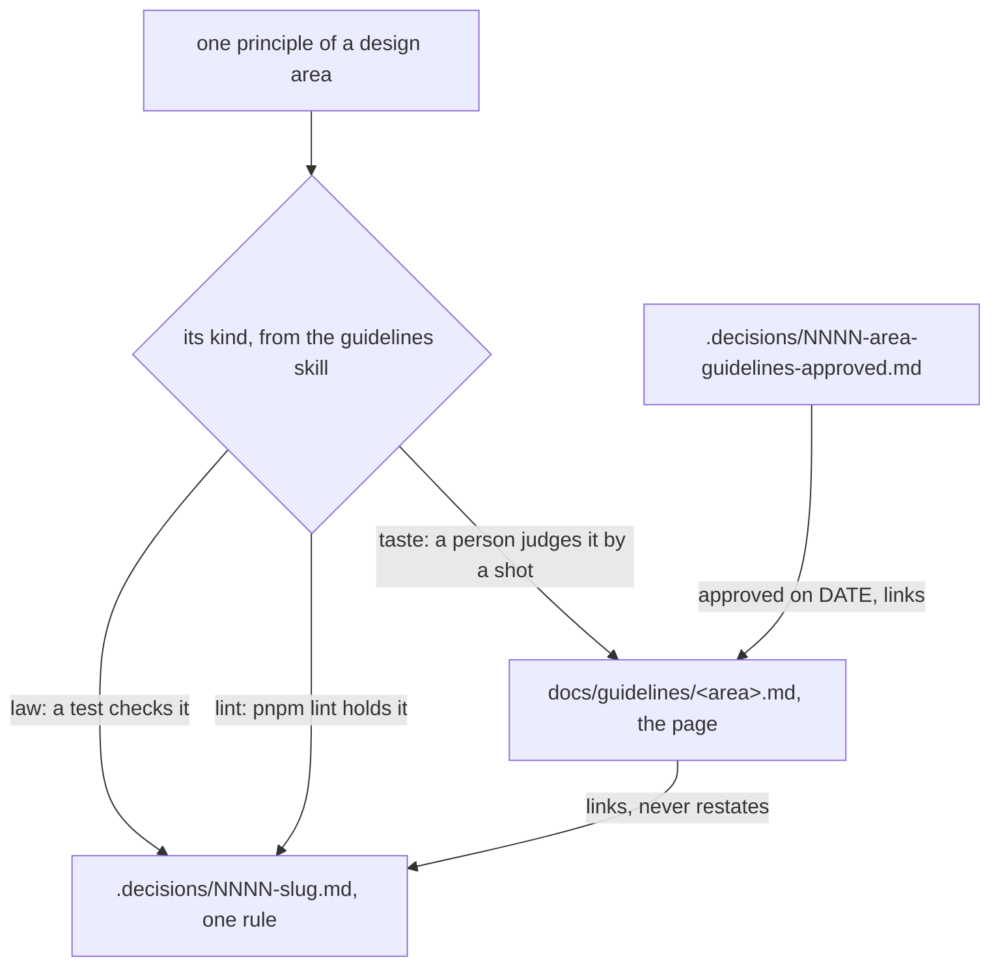

# 0136: A design area's guidelines live in one page under docs/guidelines, read whole, and its decision file records only the owner's approval



```text
before   docs/direction/tile-guidelines.md   a long note, to be split by 0130 and removed
         .decisions/0499 ... 0504            one decision file per principle
after    docs/guidelines/tiles.md            G1 to G8 together, each with its kind, reasoning, example
         .decisions/NNNN-...                 one short file: the owner approved the page on DATE
         .decisions/<law and lint files>     stay, linked from the page
```

**What this decides:** where a design area's guidelines live, and what its decision file holds.

## Context

The [guidelines skill](../.agents/skills/guidelines/SKILL.md) writes one study per design area
(tiles, pickers, labels) and ends in a set of principles, G1 to G8, each with a kind: `law` (a test
checks it), `lint` (`pnpm lint` holds it) or `taste` (a person judges it by a shot beside Linear).
[0115](0115-decided-rules-live-in-decision-files.md) moved each decided rule out of its note into
a decision file, so a tile study's taste principles became six files, 0499 to 0504.
[0130](0130-every-piece-of-knowledge-has-one-home.md) then gave each kind of knowledge one home and
removed `docs/direction/`. Neither had a home for a set of principles that is read as one piece and
changes as one piece. A taste principle is judged against its siblings, so one per file loses the
set. The owner decided on 2026-11-11 that guidelines get their own home.

This amends two decisions in part. It adds a sixth kind to 0130, a guideline, with its own home,
and a guideline note under `docs/direction/` moves there instead of being split and removed. It
changes 0115 for guidelines only: a guideline's principles live in its page, not in one decision
file each. The rest of both holds.

The known way agrees. Design systems keep guidelines as docs read whole and edited in place:
[Apple's Human Interface Guidelines](https://developer.apple.com/design/human-interface-guidelines)
and [Material Design](https://m3.material.io/) each give one topic a page of principles with
examples (their shape is cited from memory; the links were checked to resolve). An ADR records one
decision and is not edited after, only superseded:
[Michael Nygard's post](https://cognitect.com/blog/2011/11/15/documenting-architecture-decisions)
and [adr.github.io](https://adr.github.io/) ("captures a single AD and its rationale"). So the page
is the living doc, and the decision is the single act of adopting it.

## Decision

**A design area's guidelines live in one page, `docs/guidelines/<area>.md`, read whole, and the
area gets one short decision file that records only that the owner approved the page, with the
date, and links it.**

- A page holds the area's principles together. Each one carries its kind (`law`, `lint` or
  `taste`), its reasoning and its example.
- A page is a living doc. A change to a guideline is an edit to the page in a pull request the owner
  says yes to, never a new decision file per change.
- The line between the two homes: a rule that a test or a lint rule enforces stays a decision file,
  and so does a rule outside any design area. A principle a person judges, and the set it belongs
  to, lives in the page.
- The page links the decision files that enforce its `law` and `lint` principles. It does not
  restate them.
- The approval decision holds no principle. Its title names the area and the approval, so listing
  `.decisions/` still finds every approved area
  ([0008](0008-decision-discovery-is-the-agents-md-contract.md)).
- A visual area's page is a folder, `docs/guidelines/<area>/`, with the page as `README.md` and
  its shots in `shots/`. The shots are real ones from the built app, named by state and layout,
  kept in the repo as product docs (owner, 2026-11-11), not experiment assets under
  [0027](0027-experiment-results-live-in-a-private-archive.md). Each principle opens with a do and
  don't pair of shots and names its tokens from `@kampus/fabrika-design`.
- Private pages and Design canvases stay out of the repo as links, as before
  ([0468](0468-a-canvas-decides-a-look.md)).

**Binding constraints**

- No guideline note is moved or removed until the owner has seen the full inventory of guideline
  studies.
- The sweep moves one area per pull request. That pull request moves the note to
  `docs/guidelines/<area>.md`, folds the taste principles back into the page, writes the area's
  approval decision, and marks each decision file it replaces `superseded by` that decision. Law and
  lint decision files stay `accepted`.
- A sweep pull request changes no rule. A principle that looks wrong becomes a question.

## Consequences

- About 40 decision files already hold guideline principles, one per file, and this pull request
  changes none of them. Today 32 link one of seven `docs/direction/*-guidelines.md` notes: labels
  (11 files, 0348 to 0371), pipeline (6), tiles (0499 to 0504), pickers (0512 to 0516), summon
  (0073, 0518), programs (0103, 0109) and Effect code (0120). More came from studies in the same
  shape under other names, such as popovers (0509 to 0511) and fold, not tabs (0505 to 0508). The
  inventory gives the real set.
- The guidelines skill's step 7 now writes a new note to `docs/guidelines/<area>.md`, and AGENTS.md
  gains a row for the folder. The folder is made by the first sweep pull request or the first new
  study, whichever lands first.
- The cost: each area's sweep reads every decision file the note fed and sorts it into law, lint or
  taste. A file that holds both kinds splits.
- A clash to watch: [0450](0450-design-notes-sit-on-five-levels.md) says a design note splits into
  a decision note and a guideline page synced from `@kampus/fabrika-design`, never written by hand.
  This reads 0450's page as one part's reference page in the design system, and leaves it alone.
  The page here is an area's principles, written by hand. If the owner reads 0450 as covering both,
  0450 needs an amended-in-part line.
- Not decided here: where the private pressable pages and canvases are linked from, and whether a
  proposed guideline study lives in `docs/guidelines/` too. The lean is yes, marked **proposed** on
  line one as notes are today (70%; the doubt is that an undecided page beside approved ones may be
  read as a rule, which the approval decision's absence and the line-one mark should settle).

## Records

- `.glossary/TERMS.md`: a row for **guideline page**, in Records.
