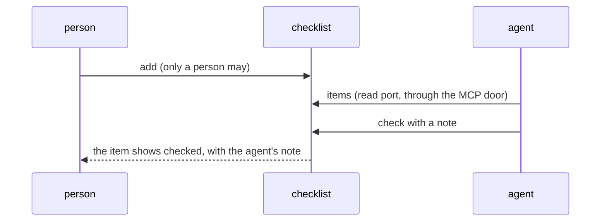

# 0137: Tier 1's program is the checklist, with an agent's note on a checked item, and notes becomes the first real app of Tier 2



```ts
// A sketch. The two additions to the checklist on main.
items: Input.cases.read.make({ schema: Schema.Null, description: "Every item, its state and note", answer }),
Schema.Struct({ type: Schema.Literal("check"), name: Name, note: Schema.optional(Note) }),
```

**What this decides:** which program carries Tier 1's whole-vehicle test in `next/`, and where
notes goes.

## Context

Tier 1's job was notes that agents write and a person reads drawn. Notes needs a text editor, a
rule for two writers, Markdown drawing and its safety laws: work about notes, not about fabrika.
[0125](0125-the-example-program-is-a-checklist.md) made the checklist the example that uses every
part of a program. The owner walked the rows left in Tier 1 on 2026-11-11 and asked what notes
still proves that the checklist does not. The read of the plan and the exam said: a person and an
agent sharing one program, and little else.

## Decision

**Tier 1's program is the checklist. Its test is one loop: a person adds an item, an agent sees
it and checks it with a short note, and the person reads the note on screen. Notes is the first
real app of Tier 2.**

- The checklist gains a read port for its items and an optional note on `check`. The agent
  reaches both through the MCP door, where an input only a person may send gets no tool.
- The notes tile and drawing a note leave Tier 1 with notes. So do the exam's laws about notes
  text and Markdown. A law about the platform that used notes as its example stays and runs on
  the checklist.
- Work that notes rows held but every program needs stays in Tier 1: durable replies, the MCP
  door, the cloud instance, a real deploy checked from a phone. Each row that named notes names
  the checklist.
- A plan re-points the rows and the exam, in the plan's own pull request. It says, row by row,
  what goes, what moves and what is lost.

## Consequences

- Tier 1 gets smaller by the notes tile and the drawing, about 21 files by the plan's own sizes.
- Lost from Tier 1, and owed to Tier 2: Markdown drawing with its safety laws, the "two writers,
  keep mine as a new note" story, and the fixture of real note text.
- The risk: a checklist with agent notes may be too thin to open every day, so fewer real bugs
  are found by use.
- How the agent learns of a new item (owner, 2026-11-11): first it asks. An agent the person
  already runs reads the items through the MCP door when told to or between its own steps, and
  nothing calls it. Next, fabrika starts an agent run for a new item, which is Tier 1's "an agent
  fabrika starts" slice and gets its own plan. A tool that waits on the list is skipped.
- This walks back part of the Tier 1 approval of 2026-11-01: the job line, the notes stories and
  the check that notes go real on Cloudflare. No numbered decision is replaced.
  [0125](0125-the-example-program-is-a-checklist.md) holds as written.
