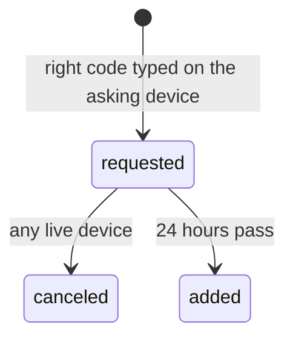
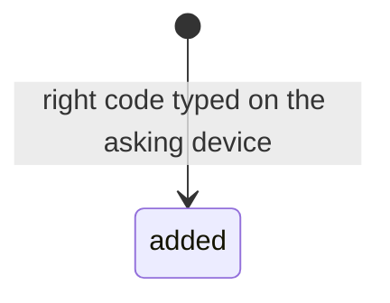

# 0138: In next/, email recovery lets the device in at once, with no wait and no step of its own to cancel or undo it

**Before:**

**After:**

The 24-hour state and the cancel are gone: the right code adds the device.

**What this decides:** whether a person waits to get back in by email.

## Context

[0338](0338-email-recovery-waits-a-day.md) made email recovery wait 24 hours, because a mailbox is
weak proof. On 2026-11-08 the owner ruled for the admin's re-invite that fabrika is for building,
not enterprise security, and that recovery gets no barriers. That principle covers this case too,
and the owner said so on 2026-11-11: a person whose mailbox is taken has lost far more than
fabrika, so the wait protects little and costs every honest person a day.

## Decision

**No wait and no special undo. The right code lets the device in at once, and it is then a device
like any other.**

- The 6-digit code typed on the asking device, its 10 minutes and 5 tries, the `verified` address
  from before the loss and the brain's email key all stay as 0338 has them.
- The email key signs the `added` at once. There is no `requested` state that waits and no alarm.
- Every live device shows a plain notice that a device came back by email. The notice carries no
  action: no Cancel and no "not me" (owner, 2026-11-11). The new device is in the list of let-in
  devices as every device is, and the list's own Remove works on it.
- The "lost or stolen?" drops apply at once with the `added`.
- No recovery path gets a waiting period. A new limit on something a person should do easily
  needs the owner's yes.

## Consequences

- Someone who holds the mailbox and no device gets in at once. The person learns of it from the
  notice and removes the device from the list. Accepted by the owner: a person whose mailbox is
  taken has lost far more than fabrika.
- P36's tests on its branch were written for the wait and the cancel. They change with this, in
  an exam pull request.
- 0338's status says amended in part: its wait, its Cancel and its `requested` and `canceled`
  events are replaced; the rest holds.
