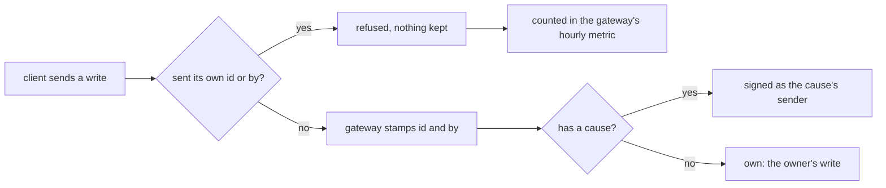

# 0140: In next/, the gateway refuses a write whose client sent its own id or by, counts each refusal in its hourly metric and never keeps it, and a write with no cause is the owner's own

**What this decides:** the two points [0261](0261-inputs-carry-their-sender.md) left open: what the
gateway does with a client-sent `id` or `by`, and who signs a write with no cause.



```ts
// The write a program asks for, as on main (runtime/Program.ts). Unchanged by this decision.
export const Write = Schema.TaggedUnion({
  caused: { parent: ParentText, event: Event },
  own: { event: Event },
});
```

## Context

[0261](0261-inputs-carry-their-sender.md) settled that the door stamps every input and that nobody
sends their own id or sender. Its "Not decided here" named two points still proposed in
[inputs carry their sender](../docs/direction/inputs-carry-their-sender.md): a client-sent `id` or
`by` being refused and recorded, and a write with no cause being `own`. The owner decided both on
2026-11-11, and changed "recorded" to "counted".

The known way: a client that may set a field the server owns is OWASP's broken object property
level authorization, the old mass assignment
([OWASP API Security Top 10 2023, API3](https://owasp.org/API-Security/editions/2023/en/0xa3-broken-object-property-level-authorization/)).
Its advice is to accept only the fields a client may set.

## Decision

**The gateway refuses a write whose client sent its own `id` or `by`, counts the refusal and keeps
nothing of it.**

- `id` and `by` are stamped by the gateway only. A write that carries either one is refused whole,
  never accepted with the field dropped, so no later reader can mistake a client's value for the
  gateway's.
- A refusal is counted, never kept. The count goes into the gateway's hourly metric, the metric
  point per piece per hour of [0038](0038-span-sink-measurements-and-metrics.md), with the refusal
  split out as [0124](0124-metrics-stay-rows-and-reading-comes-next.md) splits by a named tag.
- No ledger entry is written per refused write, and what the client sent is never stored. A row per
  refusal would grow the store without bound.
- A write with no cause is the owner's own, `own`, as the note proposed and main's `Write` already
  has it.

**Binding constraints:**

- No code path writes a ledger entry, span content or any other row holding a refused write's body.
- The refusal count lives in the metric, not in a table of its own.

## Consequences

- The build adds the named count. Today's metric point (`MetricPoint` in `telemetry/Trace.ts`,
  written by `rollup` in `telemetry/internal/measurements.ts`) holds `count` and `errors` per piece,
  with no named split yet; 0124's tag with a closed list of values is the shape to follow, and the
  build's plan picks the tag and its values.
- The refused request still ends its span, so its measurement row is written and kept forever, as
  [0202](0202-spans-and-measurements-kept-forever.md) says of every row. That row holds timing and
  an error class, never the body.
- `own` needs no code: main's runner already signs an `own` write as the job's own and refuses one
  for a person-only kind (`runtime/Runner.ts`).
- Not decided here, a ticket follows: a rate limit per sender at the gateway, since every finished
  request writes a measurement row kept forever, refused or not. The owner's lean is a Durable
  Object as the limiter; the ticket compares it with the platform's own rate limit binding, used
  through Alchemy ([0042](0042-platform-pieces-go-through-alchemy.md)).
