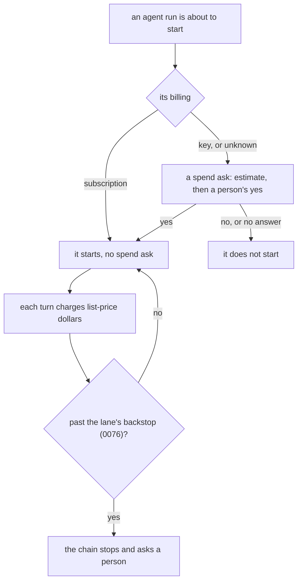

# 0141: An agent run on a flat subscription starts with no person's yes to a spend estimate, while a run billed by the token still needs one



```ts
// A sketch, next/. The `billing` the run's `started` fact already records
// (one-ask-and-one-meter.md, "The meter on subscriptions") decides whether a spend ask is needed.
const needsSpendYes = (billing: Billing | undefined): boolean =>
  billing?._tag !== "subscription"; // a key, or a billing nobody could read, still asks
```

**What this decides:** an agent run on a flat subscription needs no person's yes to a spend
estimate before it starts; everything else about spend stays as it was.

## Context

[One ask and one meter](../docs/direction/one-ask-and-one-meter.md) says a person's yes to a cost
estimate is the only thing that can set a dollar limit, and that spending with nobody's yes is
refused. Its section "The meter on subscriptions" (2026-11-07) found that fabrika's agents run on
flat subscriptions, so their dollars are list price for comparison, not money paid. It left one
question open: does a run on a subscription still need that yes before it starts? The owner
settled it on 2026-11-11.

No decision file held the spend-yes rule; the note does, so this file amends none. It sits beside
[0076](0076-a-lane-stops-at-its-budget.md) (the lane's budget) and
[0022](0022-codex-steps-run-on-astra-at-medium.md) (list prices on field rows), and changes
neither.

## Decision

**An agent run whose billing is a flat subscription starts with no person's yes to a spend
estimate (owner, 2026-11-11).**

- A subscription run costs no extra money, so the spend ask has nothing to guard for it.
- A run billed by the token keeps the note's rule unchanged: an estimate, a person's yes, and a
  dollar limit that points at that yes. Jev calls are billed by the token, so they keep it too.
- A run whose billing cannot be read counts as billed by the token. The note never guesses
  `billing`, so a missing one is never read as a subscription.
- [0076](0076-a-lane-stops-at-its-budget.md)'s lane budget stays the stop, list-price dollars
  included: a subscription run's charges still count toward the lane's backstop.
- Every run still records its dollars at the provider's list price, for comparison, as `AGENTS.md`
  asks.

**Binding constraints:**

- No run billed by the token, or with unknown billing, starts without a person's yes to its
  estimate.
- No subscription run skips its list-price charge.

## Consequences

- In `next/`, the ledger's `hold` stops answering `no_limit` for a run whose `billing` is
  `subscription`; for every other run it answers as the note says.
- The cost: nothing holds a subscription run back for money until a quota check exists. A runaway
  run uses up the subscription's limit (its five-hour or weekly window), and that stalls every
  other run on the same login. Only 0076's lane stop catches it, and only at the lane's backstop.
- Not decided here: the quota check itself, what reading of a quota stops a run, and who answers
  when it does.
