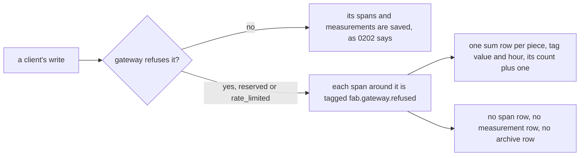

# 0143: In next/, a write the gateway refuses is counted by the hour and writes no span row and no measurement row

**What this decides:** what is stored when the gateway refuses a write. Only a count per hour.



```ts
// Sketch, after 0124's named tag. One row per piece, value and hour, however many refusals.
type RefusedSum = {
  piece: "gateway.route" | "runtime.rpc" | "connection.frame";
  refused: "reserved" | "rate_limited"; // a closed list
  hour: number;
  count: number;
};
```

After N refusals in one hour, every table holds the same rows as after 1.

## Context

[0140](0140-gateway-refuses-client-id-and-by.md) said a refused write is counted and its body is
never kept, but its consequences still let the refused request end its span and write a measurement
row kept forever, as [0202](0202-spans-and-measurements-kept-forever.md) says of every row. It named
a rate limit per sender as the answer to that growth. The plan for ticket 844 (the stamped-key
refusal) found that the bound is simpler to hold at the source, and the plan for ticket 843 (the
rate limit) needs the same rule: a refusal for being over the limit that still writes a row bounds
nothing.

## Decision

**A write the gateway refuses changes one hourly count per piece and writes nothing else.**

- This covers every refusal the gateway counts under a closed `fab.gateway.refused` value: today
  `reserved` (0140's client-sent `id` or `by`) and `rate_limited` (ticket 843).
- Every span that encloses the refused call follows it: the gateway's, the connection's RPC span
  and the frame span. Each is tagged before it ends, counted in its own piece's sum and not saved.
- No ledger entry, span row, measurement row, unsent row, archive row or held object grows per
  refusal. A count that cannot be written yet is held as one count per piece, value and hour.
- The refused body is stored nowhere, as 0140 already says.
- A write the gateway accepts is unchanged: its spans and measurements are kept as 0202 says.
- Other refusal reasons keep today's rows until one joins the closed list by its own decision.

**Binding constraints**

- The bound is a law: after N refusals in one hour, for any N, each table has the same rows as
  after 1, and the piece's sum went up by N.
- The tag's values stay a closed list. No sender key, method, trace id or request id splits it.

## Consequences

- 0140's consequence "the refused request still ends its span, so its measurement row is written and
  kept forever" no longer holds. The rest of 0140 stands.
- 0202's "every span and every raw measurement is kept forever" has one exception: a call the
  gateway refuses under the closed list. 0124 already made one of the same kind, a poll with no news.
- Lost for good: the timing of each single refusal, and which sender was refused. The count per
  hour stays. If per-sender refusal history is wanted later, it is a new decision with its own bound.
- The rate limit (ticket 843) still lands: it bounds accepted work, which does write rows.
- Not decided here: the limit's numbers and its window rule, which ticket 843's plan carries.
