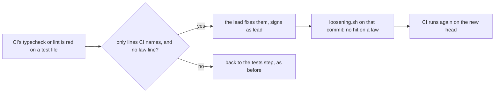

# 0144: The lead may fix the lines CI's typecheck or lint names in a test file, when a check shows no law changed

**What this decides:** who may make a small type or lint fix in a test file after a lane's steps
passed. The lead may, under a check, so the fix does not cost a whole lane round.



```sh
# One commit, signed as lead, holding only the fix.
sh .agents/skills/step-commit/scripts/stepcommit.sh lead <ticket> "<what CI named>" <the test file>
sh .agents/skills/lead/scripts/loosening.sh HEAD~1 HEAD   # must show no law changed
```

## Context

On 2026-11-12 three lanes (tickets 770, 852 and 869) passed tests, build and review and then met a
red `typecheck` job. Each failure was a type or an Effect diagnostic on a few lines of one test
file: a parameter with no type, a local name that hid a built-in type, an `Effect.tryPromise` whose
`catch` returned `unknown`. A step box runs no type check
([0133](0133-no-push-waits-on-a-local-typecheck.md)), so the lane cannot see these before CI does.
Only the tests step signed test files, so each one-line fix cost a full round of tests, build and
review, about 20 minutes and a few dollars, for no change to any law.

The rule this bends is [nobody writes their own exam](../docs/direction/nobody-writes-their-own-exam.md).
The lead does not build the product, so the lead fixing a type in a test is not a builder writing
its own exam. The check below keeps it that way.

## Decision

**The lead may change a test file to fix exactly what CI's typecheck or lint names there, in a
commit of its own signed as lead, when a check shows no law changed.**

- Only the lines a red `typecheck` or lint job names, and what those lines need (an import, a
  type, a typed error).
- No law line changes: no assertion, generator, run count, seed, timeout, skip, `it.fails` or
  retry is added, removed or changed, and no test is added, removed or renamed. `loosening.sh` on
  that one commit must report none of these. A hit on one sends the fix back to the tests step.
- The commit holds nothing else, and its message quotes what CI named.
- CI runs again on the new head, and the pull request lands by
  [0014](0014-the-lead-merges-when-every-step-passed.md) as before.
- A failing test, a wrong expectation or a missing test double is not this: it goes back to the
  tests step.

**Binding constraints**

- The lead never signs as `tests` or `build`.
- The lead never changes product code this way.
- A fix that needs a law line touched is the tests step's, with no exception for size.

## Consequences

- A type-only miss costs minutes, not a lane round.
- The lead reads and writes a few lines of exam code. The check, not trust, is what bounds it: if
  `loosening.sh` cannot tell that a change is safe, the change is not the lead's.
- Not decided here: whether a step box should run a type check of its own, and whether the build
  step may make the same kind of fix.
