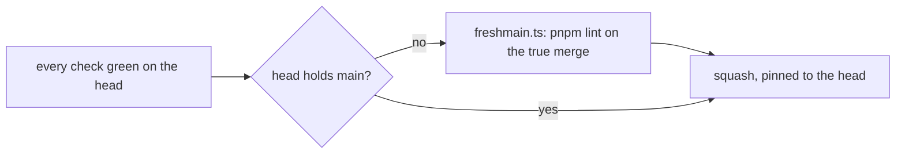
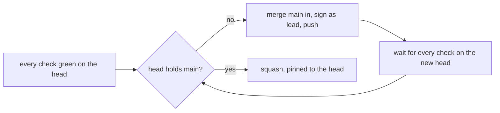

# 0146: A pull request lands only when its checks ran on a head that holds current main

**What this decides:** the lead's merge script merges main into a pull request that is behind, waits for the full checks on that head, and only then lands it; a green head that is behind main no longer lands as it is.

**Before:**



**After:**



```sh
# before (0097): green and clean, so it lands behind main after one lint
pr 1031: every check is green at <sha>; it lands without catching up with main (0097)
# after: behind main means catch up first, whatever the checks say
pr 1031: main moved to <sha>; merging main in
```

The one box that moves: a head that lacks main goes around the loop once more, and the tests and
the type check run on it before it lands.

## Context

[0097](0097-a-green-pull-request-lands-without-catching-up.md) let a green pull request that
merges cleanly land behind main, with only `pnpm lint` run on the true merge. It said where a clash
between two pull requests would show: main's own CI run after the merge.

On 2026-11-12 it showed there. Pull requests 1058 and 1031 were each green alone and merged 19
minutes apart. Together they broke `next/apps/fabrika/e2e/chaos-revoke.test.ts`: one added a test
with its own fixture worker, the other added an entrypoint every process load binds, and the
fixture did not export it. Lint could not see that. Main stayed red for 47 minutes, every other
merge waited, and one pull request was sent back to its build step for a fault that was main's.
Pull request 1073 fixed it.

## Decision

**The merge script lands a pull request only when every required check is green on a head that
holds the main it just fetched (owner, 2026-11-12).**

- A head that lacks main is caught up first: main is merged in, the merge commit is signed as lead,
  the branch is pushed, and the script waits for every check on the pushed head.
- When main moved again while it waited, it goes around once more. Each wait keeps its bound.
- A conflict is refused, as before. The lane merges main and pushes.
- `freshmain.ts`'s lint on the true merge has no case left to guard and goes with this change.

**Binding constraints**

- The head stays pinned at the squash, with no override flag.
- No auto-merge and no force push.
- This is the stopgap until the merge queue's first stage
  ([0111](0111-merge-queue-stage-1-is-a-tier-1-row.md)), which tests the true merge by design.

## Consequences

- Two pull requests that pass alone and break together are caught before the second one lands.
- It costs one more full CI run, about 15 minutes, whenever main moved since the pull request's
  last run. On a day with many merges they land one after another, not side by side.
- A pull request that waits on CI while main moves may go around more than once. The script says
  each round in one line, so a slow merge has a visible reason.
- 0097 is superseded. [0049](0049-merge-behind-main-once-lint-passes-on-the-true-merge.md) is
  amended in part: its "may land behind main once lint passes" no longer holds; its pinned head and
  its no-override rule do.
- Not decided here: running fewer jobs on the catch-up run, and what the merge queue replaces.
