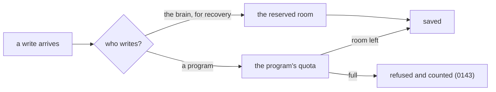

# 0147: The brain keeps reserved room for its own recovery writes, counted apart from program writes

**What this decides:** a program that has used up its write quota cannot stop the brain from writing what it needs to recover that program.



```ts
// Sketch. The two counts never share a number.
{ _tag: "program", process, used: 4_812, limit: 5_000 }
{ _tag: "recovery", process, used: 3, reserved: 64 }
```

## Context

Tier 1's P34c slice 4 gives each program a quota of ledger writes, with caps taken from slice 3's
measured numbers. The runner also writes for itself: the recovery journal, an exit entry, a dead
letter, a restart. If those counted against the program's quota, a program that filled its quota
would leave the brain unable to record its crash or restart it, and the process would be stuck with
no entry saying why. Slice 3's plan carried this forward as slice 4's one open question.

Others keep the same kind of room. PostgreSQL holds back `superuser_reserved_connections` so an
operator can still connect when every ordinary slot is taken. ext4 reserves blocks for root so a
full disk can still be repaired.

## Decision

**The brain's recovery writes for a process come from reserved room of their own and never from
that program's quota (owner, 2026-11-12).**

- A recovery write is one the runner makes to keep or restore a process: its journal, its exit,
  its dead letter, its restart. Slice 4's plan lists them from the code and names each.
- The two are counted apart and recorded apart, so a reading of a program's use never includes the
  brain's writes.
- The size of the reserved room is a setting with a default
  ([0069](0069-choices-are-settings.md)), taken from slice 3's measured numbers.
- A program can never write into the reserved room, by any path.

**Binding constraints**

- Reserved room that runs out is a fault the brain reports by name. It never borrows from a
  program's quota and never drops a recovery write without a record.

## Consequences

- A full quota refuses the program's next write and nothing else: its crash, its restart and its
  dead letters are still written.
- It costs a little room no program can use, and one more setting.
- Not decided here: the reserved room's default size, and what the brain does when it runs out
  beyond reporting it. Both belong to slice 4's plan.
