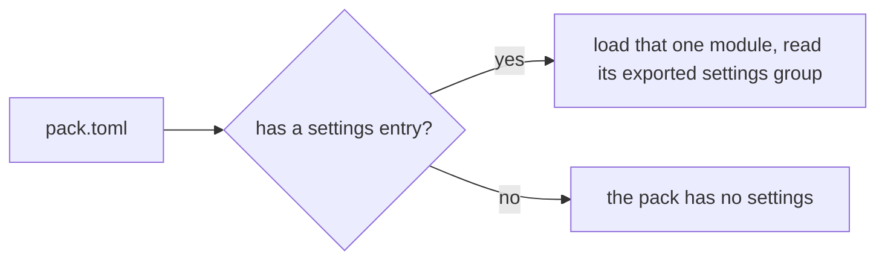

# 0148: pack.toml names the module that exports the pack's settings, never a fixed file name

**What this decides:** how fabrika finds a pack's settings schema when it loads the pack.



```toml
# pack.toml
name = "timer"
settings = "./settings.ts"   # optional
```

```ts
// settings.ts, a sketch: one exported group
export const settings = Setting.group("timer", { period: Setting.make(/* ... */) });
```

## Context

[0083](0083-every-program-in-a-pack.md) gave each pack one settings schema and left open how it is
found at load, with a lean: `pack.toml` names the file. The settings plan carried it as its one
open question, due before Tier 1's P38 slice 5 (listed local packs). The other choice was a fixed
file name beside the manifest, with no line to write.

Manifests elsewhere name their entry points: `main` and `exports` in npm's `package.json`, `path`
under `[lib]` in Cargo's `Cargo.toml`.

## Decision

**A pack that has settings names their module in `pack.toml` with an optional `settings` entry, a
path relative to the manifest (owner, 2026-11-12).**

- The module exports one settings group named `settings`.
- No entry means the pack has no settings. Fabrika does not look for a file by name.
- A named module that is missing, or that exports no `settings` group, fails the pack's load with
  an error that names the manifest and the path.

## Consequences

- Fabrika loads only what the manifest names. A file that happens to be called `settings.ts` is
  never run by accident, and an author may keep the module where they like.
- It costs one line in the manifest of each pack that has settings.
- 0083's open point is closed. Not decided here: more than one settings module per pack.
