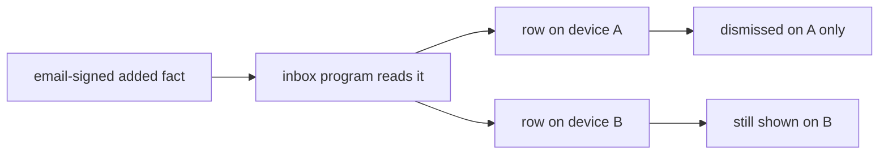

# 0151: A thin inbox is a Tier 1 row, and the email recovery notice is its first row, never a toast

**What this decides:** Tier 1 gains a row, P45: an `inbox` program in `next/` that shows only
notices from the brain, with the email recovery notice as its first row.

## Context

[0138](0138-email-recovery-lets-in-at-once.md) says every live device shows a plain notice when a
device comes back by email. [0150](0150-the-recovery-notice-is-a-toast-for-now.md) drew it as a
toast until notification guidelines exist. The owner then saw that a notice that waits for a
person is what the inbox is for ([0480](0480-the-inbox-is-one-program-two-views.md),
[0521](0521-an-agents-message-is-an-inbox-row.md)), and that Tier 1 has no inbox. This replaces
0150 and adds a second program beside the checklist of
[0137](0137-tier-1s-program-is-the-checklist.md), which stays Tier 1's example program.

## Decision

**Tier 1 builds a thin inbox, and the recovery notice lands there (owner, 2026-11-12).**

- P45 is an `inbox` program in `next/`. It shows notices from the brain and nothing else.
- Its first row is 0138's notice. No toast is built for it.
- A row is read from a fact already in the ledger, here the email-signed `added`. The notice
  adds no write and still carries no action: the list of let-in devices is where a person removes
  a device.
- A person dismisses a row on the device in front of them, and that dismissal is kept on that
  device only. Every other device keeps showing the row until its own person dismisses it there.
  So a device that got in by email cannot clear the warning for the person's real devices.
- Left out, each staying in its later tier: asks, messages from agents and people, replies, the
  top bar glance and the phone slice.

**Binding constraints**

- The thin inbox grows into the full one. Its plan reads 0480, 0482 and 0521 first and adds no
  shape the full inbox would have to undo.
- A dismissal never travels to another device and never removes the `added` fact.

## Consequences

- Tier 1 has 44 rows; it had 43. P45 is not planned or sized yet. It needs P11 and, for its
  first row, P36.
- 0150 is superseded. The question it left open, whether a toast may hide on a timer, goes away.
- P36's plan shows the notice through the inbox, so P36's last slice waits on P45 or lands its
  notice with it.
- Not decided here: how an inbox row looks. That waits on the inbox's own look step and on
  notification guidelines.
