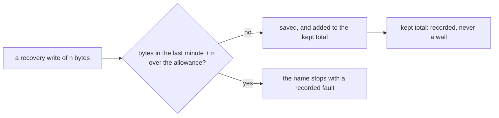

# 0152: The brain's recovery byte allowance is a rate, and the kept total is recorded, never limited

**What this decides:** the room the brain keeps for recovery bytes limits how fast recovery writes,
per rolling minute, and puts no cap on how many recovery bytes are kept in all.



```ts
// Sketch, next/. One name at one location.
{ _tag: "recovery", location: "process", window: 60_000, bytes: 19_870, allowance: 207_410, kept: 1_202_903 }
// `bytes` counts recovery bytes committed in (now - 60,000, now] and is what the allowance limits.
// `kept` only grows and is only recorded.
```

## Context

[0147](0147-the-brain-keeps-reserved-room-for-recovery-writes.md) gave the brain reserved room for
its recovery writes, with its size a setting taken from measured numbers. P34c slice 4's host
measurement (tracker ticket 882, `next/`) then found that kept recovery bytes never level off. The
Project location gains about 550 bytes per input for as long as the project lives, and the Process
location keeps a full checkpoint row per process life. Trimming them is ruled out: nothing is
dropped to stay under a cap ([0200](0200-no-object-grows-forever.md)). So a cap on the kept total always fills in the end, and on that day
an old project could no longer be recovered, with no fault of its own.

Others limit a rate where a total cannot be bounded. PostgreSQL's `max_slot_wal_keep_size` is the
contrast case: it caps a total only because old WAL may be thrown away. Kubernetes limits events
per source per minute and leaves the store's size to compaction.

## Decision

**The recovery byte allowance limits recovery bytes written per rolling minute, for one name at one
location; the kept total is recorded and has no limit (owner, 2026-11-12).**

- The window is the same rolling minute the recovery write allowance uses. The account keeps bytes
  beside write counts in its timestamp groups.
- The settings are `limits.recovery.process.bytes` and `limits.recovery.project.bytes`, in bytes
  per minute. Their defaults come from slice 4's measurement by the plan's formula: 207,410 and
  74,080.
- The kept total per name and location is written on every recovery write, so a slow leak can be
  seen and asked about later. Nothing reads it to refuse a write.
- A fault from the rate is cleared as slice 4's plan says, by a checked person restart, never by
  the window moving on alone.

**Binding constraints**

- No recovery path may be refused because of the kept total.
- A program still cannot write into the recovery room by any path (0147).

## Consequences

- 0147's sketch showed the reserved room as one total (`reserved: 64`). For bytes that is now a
  rate. The rest of 0147 holds.
- How the object that holds these rows stays bounded is 0200's answer, a roll or a seal at its
  cap. This decision only says the kept total never refuses a recovery write.
- Cost: a slow leak in recovery writes is not stopped, only recorded. Whole-object storage is the
  wall behind it, and Process storage has no cap of its own yet (a finding row holds that).
- Not decided here: whether the door's own record of an input counts as a program write (the
  plan's question 2), and any alarm on the kept total.
