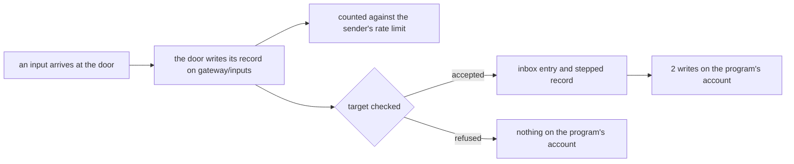

# 0153: The door's own record of an input is door work, never counted as a write of the program it is for

**What this decides:** when an input arrives, the record the door keeps of it does not use up any
of the target program's write quota.



```ts
// Sketch, next/. One accepted input, three rows, two payers.
{ stream: "gateway/inputs", _tag: "received" } // the door's; the sender's rate limit is its wall
{ stream: "inbox", _tag: "input" } // the program's account: 1
{ stream: "ledger", _tag: "stepped" } // the program's account: 2
```

## Context

P34c slice 4 (tracker ticket 882, `next/`) gives each program a quota of writes per minute. Its host
measurement found that every input makes one inbox entry and one record on the door's own stream,
`gateway/inputs`. The plan had to say who pays for the door's record.

Three facts point one way. The door writes its record before it checks the target, so it also
writes one for a refused input and for a call to the door itself, where no program is to blame. The
record sits on the door's stream, not the program's. And it already has a wall of its own: the
door's saved rate limit per sender, which merged on 2026-11-12 (tracker ticket 843).

Kubernetes does the same split: the API server's audit log of a request is not charged to the
namespace's object quota, and API Priority and Fairness limits the caller.

## Decision

**The door's record of an input is counted as door work, against the sender's rate limit, and never
against the target program's write quota (owner, 2026-11-12).**

- An accepted input costs its program 2 writes: the inbox entry and its `stepped` record.
- `limits.writes` defaults to 13,760 a minute, from that count of 2. The 20,640 a count of 3 would
  give is not used.
- The same holds for the door's binding and session rows for an input.

## Consequences

- Cost: the door's record copies the input's body, so those bytes sit outside every program's
  storage cap. Their wall is a rate per sender, not a total.
- A program cannot be pushed over its quota by inputs the door refuses.
- Not decided here: a cap on the door's own stream, which
  [0200](0200-no-object-grows-forever.md) asks every growing object to name.
