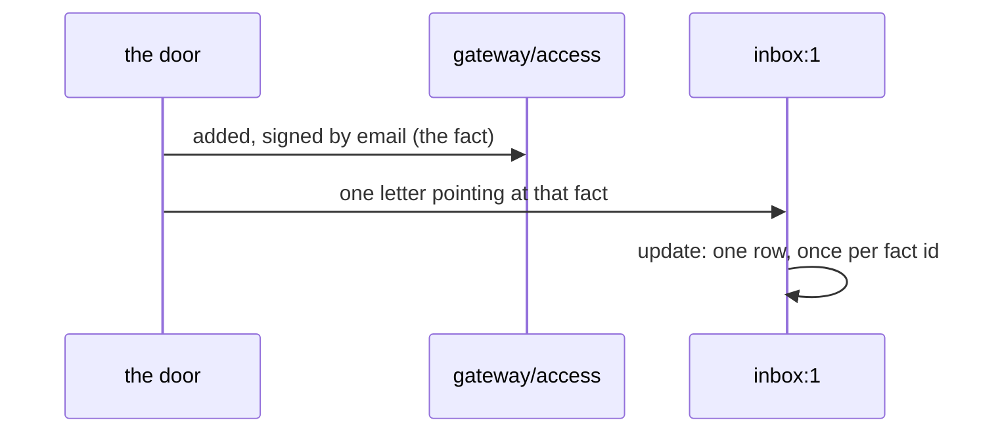

# 0154: The brain mails the inbox program one letter per notice, so a notice adds no fact but does add a letter

**What this decides:** the inbox program learns about a notice the way every program learns
anything, by a letter in its own stream, and the brain sends that letter.



```ts
// Sketch, next/. The letter names the fact; it copies no new truth.
{ type: "added", id: "<the added fact's id>", device: "<label>", at: 1794520000000 }
// The inbox's Model is { rows }, and a repeated id adds no second row.
```

## Context

[0151](0151-a-thin-inbox-is-a-tier-1-row.md) made P45 an `inbox` program and said its first row "is
read from a fact already in the ledger" and that "the notice adds no write". P45's plan (tracker
ticket 884, `next/`) found the two do not fit: in Tier 1 a program learns only from letters in its
own stream. Reading another stream from a program is Topic, and Topic is Tier 2's walk.

The other way out was to build no program: each device's window reads `gateway/access` and folds
it. That writes nothing, but then the tile is not backed by a program, and the full inbox would
have to undo it.

Erlang/OTP does it with mail: a process learns of an event because another process sends it a
message. Tier 2's health lines already say "one mail to the desk".

## Decision

**For each email-signed `added`, the brain mails one letter to the inbox program's own stream, in
the same write turn; the letter points at the fact and is the only thing the notice adds (owner,
2026-11-12).**

- "The notice adds no write" in 0151 now reads "the notice adds no fact". The `added` fact stays
  the one truth. The letter carries its id.
- Only the brain may send this letter. A person, an agent or a recovered device that sends it is
  refused.
- One row per fact id, however many times the letter arrives.
- The notice still carries no action, and a dismissal still never leaves its device (0151).

## Consequences

- 0151 is amended in part; its other rules hold. The recovery note and the glossary's inbox rows
  change their wording in the pull request that builds the letter.
- P45 slice 1, already in its lane on this shape, is no longer built on a lean.
- Cost: one more write per email recovery, in the brain's write turn. A recovery is rare.
- When Topic exists, the inbox may read the fact's stream instead. That is Tier 2's call and
  would retire this letter.
- Not decided here: whether a device shows notices older than its own let-in, and how the row
  looks.
