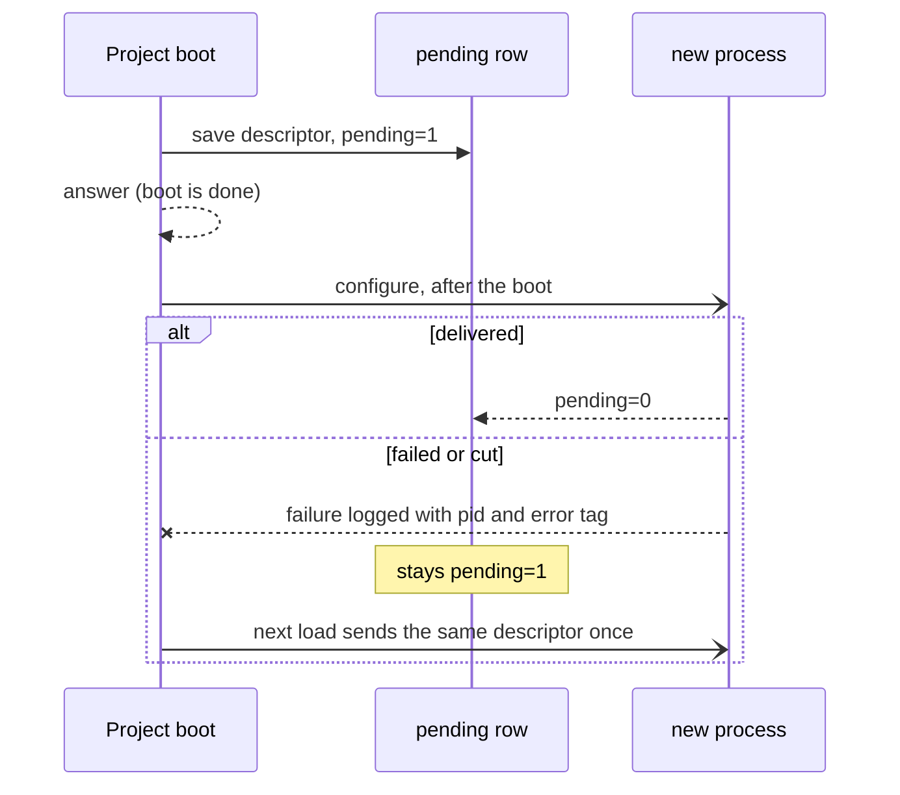

# 0155: A start the Project makes while it boots never holds the boot, and a failed one stays pending and is sent again

**What this decides:** in `next/`, when the Project starts a process as part of its own boot, the
boot answers without waiting for that start, and a start that fails is logged, kept pending and
sent again on the next load.



```ts
// A sketch. Two different places in the code, so no flag picks the path.

// Asked for by someone (start, processStart): waits, and its failure is the caller's answer.
yield* configure(pid, descriptor);

// The Project's own boot (its first process, and pending rows from before): after the boot.
yield* Effect.forkScoped(Effect.forEach(pending, ([pid, d]) => deliver(pid, d)));
```

## Context

Scheduled jobs (ticket 762, pull request 1009) made a new process run its first step when it is
configured, so its alarm is set without a client call. That first step asks the Project for the
process's status. During the Project's own boot the Project is still building and waiting on that
same configure, so each waits on the other and neither ends.

Erlang/OTP has the same trap, a process that calls its starter from `init/1`. Its answer is
`handle_continue`: `init` returns first, and the rest runs right after, before the next message.

The pull request's tests changed two pinned laws to match: a boot whose delivery fails or is cut
now answers, where it failed before. That is a law that changed its meaning, so it came to the
owner.

## Decision

**A start made during the Project's own boot runs after the boot, never inside it.**

- It covers two cases only: the Project's first process, and pending rows left from an earlier
  load.
- The descriptor is saved with `pending=1` before the boot answers. It is never lost.
- A delivery that fails or is cut leaves the row pending and writes a log line with the process
  id and the error's tag. It is never silent.
- The next load sends the same descriptor once and clears `pending` when it is delivered.
- A start someone asks for after the boot still waits, and its failure is still that caller's
  answer.
- A malformed pending row still fails the boot. This decision does not cover it.

**Binding constraints**

- No call made during the Project's boot waits on a callback into the Project.
- No flag chooses between the two paths. A boot-time start and an asked-for start are different
  places in the code.

## Consequences

- A caller of the boot no longer learns of a failed boot-time start from the boot's own answer. It
  shows in the log and in the pending row.
- The retry is automatic, on the next load. Nothing retries inside one load.
- The row in [the OTP table](../docs/direction/follows/otp.md) for a process's first step names
  `handle_continue` for this case; the pull request that lands the behavior adds it (0017).
- Not decided here: whether a start that stays pending across many loads should raise anything to a
  person, and what several boot-time starts at once should do if one of them never delivers.
