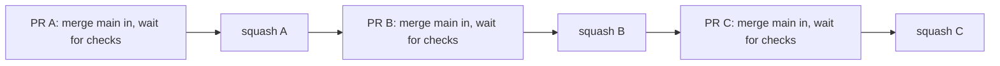
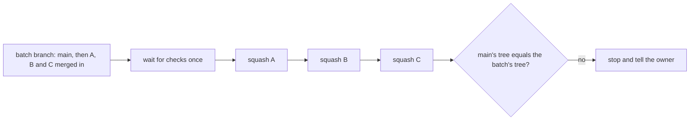

# 0156: A batch of pull requests may land on one check run of their combined merge, as a measured trial

**What this decides:** the lead may test several finished pull requests together on one throwaway branch, and when its checks pass, land each of them as its own squash, in order, with no check run in between.

**Before:**



**After:**



```sh
# before (0146): one full check run per pull request, about 15 minutes each
catchup.sh 1088 843 && catchup.sh 1090 885 && catchup.sh 1069 877
# after: one check run for the batch, then three squashes under one lock
git merge origin/<branch of 1088> origin/<branch of 1090> origin/<branch of 1069>   # on the batch branch
```

What moves: the wait happens once, on a branch that holds main and every member, and the three
squashes follow it with nothing let in between.

## Context

[0146](0146-a-pull-request-lands-only-on-ci-that-saw-main.md)
made every pull request pass its checks on a head that holds current main. Each merge moves main,
so every waiting pull request merges main in and runs its checks again. A check run takes about 15
minutes, so at best four land in an hour. On 2026-11-12 twelve landed between 12:40 and 16:25,
only two of them after 14:34, with more than 25 open.

The known way is a batch: bors and GitHub's merge queue test several pull requests as one merge
and land them together. [0111](0111-merge-queue-stage-1-is-a-tier-1-row.md) plans batches for a
later tier. The owner said yes to doing it by hand now, and asked for it to be measured.

## Decision

**A batch lands on one check run: the checks of the combined merge count for every member (owner,
2026-11-12). This is a trial, and it is measured.**

- The batch branch starts at current main and merges each member's head in, in the landing order.
  It gets its own pull request so the checks run, and that pull request is closed, never merged.
- A member that conflicts with main or with an earlier member stays out. Its lane merges main and
  it joins a later batch.
- Each member lands as its own squash, pinned to its head, in the batch's order. The catch-up lock
  is held from before the first squash until after the last, and main must not have moved since
  the batch branch was made.
- Before each squash, the tree of "main as it now stands, plus this member" must equal the tree
  the batch branch had after merging that member. After the last squash, main's tree must equal
  the batch branch's tree. A difference stops the batch and goes to the owner.
- Every other rule of the merge script holds for each member: its commits are trusted for its
  ticket, the leak grep is clean, and the lead has read `loosening.sh`.
- A red batch is split in half and each half is tried again. A check that failed in a test no
  member touched may be run again once, and only while a fix for that test is in flight
  ([0036](0036-a-flaky-test-is-fixed.md)).
- The write-up in `experiments/` gives pull requests landed per hour and check runs per landed
  pull request, for one-at-a-time on 2026-11-12 and for the batches.

**Binding constraints**

- No auto-merge, no force push, no override flag. A member's head stays pinned at its squash.
- Main is only ever a tree that passed the checks, or one squash away from one inside a batch that
  is still landing under the lock.

## Consequences

- 0146 is amended in part: a member of a green batch lands without its own check run on a head
  that holds main. Outside a batch 0146 holds as written.
- One check run can land three to five pull requests. A red batch costs more runs than it saves,
  so the trial's numbers depend on how often a batch goes red.
- The batch is run by hand, with the steps kept on the experiment's branch, until the trial is
  read. If it helps, it becomes code in the lead's merge tooling or in the merge queue. If it does
  not, this decision is superseded and 0146 stands alone.
- Not decided here: testing ahead (a second batch on top of one still in its checks), and what the
  merge queue does.
