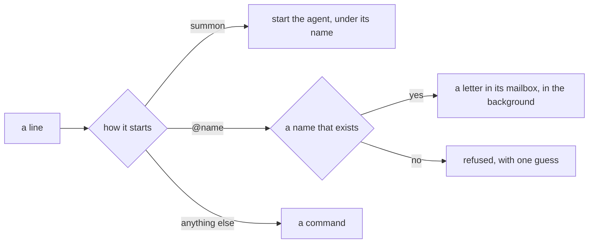

# 0157: The summon line is the one way to start an agent, and @name only talks to a name that already exists, from any text box, in the background



```text
tsh$ summon claude haiku as scout
tsh$ summon codex as researcher
tsh$ @scout why does post print #7 twice?
tsh$ @Scout hi
tsh: no agent named Scout. Did you mean scout?
```

**What this decides:** how a person starts an agent and how they talk to it, in both versions:
`tsh` today and `fabsh` in `next/`.

## Context

[0518](0518-you-summon-with-at.md) says `@` is how you summon, that there is no `summon` word, and
that an `@` with no such agent on the desk starts one. That was decided on 2026-11-05 and taken
back the next day: [talk where you work](../docs/direction/talk-where-you-work.md) says, dated
2026-11-06, that `summon` starts an agent by name and that `@` talks only to an agent summoned
already. [Summon guidelines](../docs/direction/summon-guidelines.md) and the glossary's `summon` row
say the same.

0518 was written on 2026-11-11, when the notes were moved into decision files. It was copied from
a bullet in [shared tiles](../docs/direction/shared-tiles.md) that was never marked as taken back.
So the decision file stated a rule the owner had already reversed.

Today's code is on the later rule. `summon`, `dismiss` and `agents` are built-ins
(`packages/fabrika/src/shell/grammar.ts:93`), the line is
`summon <agent> [model] [effort] as <name>` (`packages/fabrika/src/shell/builtins.ts:31`), and an
`@` to a name nobody summoned is refused (`packages/fabrika/src/shell/said.ts:65`).

The owner said it again on 2026-11-12, for `fabsh`: one way to start an agent. A name alone cannot
pick between harnesses, so a line that starts an agent has to name the harness.

This replaces 0518. Its two rules that still hold are restated below, so one file holds the whole
rule.

## Decision

**The `summon` line is the one way to start an agent, and `@name` only talks to a name that
already exists.**

- `summon <agent> [model] [effort] as <name>` starts an agent. `<agent>` is the harness, such as
  `claude` or `codex`. `<name>` is the person's own word for it, so two agents of one harness run
  side by side under two names.
- It is a paid run, started on purpose. Nothing else starts one: no `@`, no text box, no palette
  row.
- `@name <words>` talks to that name. With no such name, the line is refused with one guess, and
  nothing starts.
- A name is a summoned agent today. People and connectors share the same list of names, and `@`
  reaches each the same way: a letter in the name's mailbox
  ([summon guidelines](../docs/direction/summon-guidelines.md#a5-every-name-is-a-mailbox-address),
  decided 2026-11-07). A person is never summoned; a connector is registered by the same line, as
  `summon linear from linear`, whose `from` grammar is not written yet.
- `@` works in every text box, the command palette included (2026-11-07, kept from 0518).
- An `@` line runs in the background, as if it ended in `&`. It never takes over the person's
  prompt, and a busy agent is no reason to refuse it: the line lands in the name's mailbox and
  waits its turn (2026-11-07, kept from 0518).

**Binding constraints**

- A design for `fabsh` has no second way to start an agent.
- A text box that takes `@` completes only the names that exist now.
- A rule for `@` holds for an agent, a person and a connector alike. None is written so that only
  an agent can meet it.

## Consequences

- 0518 is superseded. The bullet in shared tiles it was copied from is marked as taken back.
- Built today, in today's version: the `summon` line and its refusals, and `@name` in `tsh`.
- Decided and not built, in today's version: `@` in a text box other than `tsh`, and the
  background `@` line. Today an `@` line runs in the foreground
  (`packages/fabrika/src/shell/grammar.ts:178`).
- Nothing of this is built in `next/` yet.
- Not decided here: rooms, `join` and `fork`, which are in summon guidelines, still proposed; and
  which agents may be summoned beyond the harnesses in `packages/fabrika/src/agents/acp/harness.ts`
  ([0517](0517-a-tile-holds-you-and-your-agents.md) says any agent that speaks the agent link).
