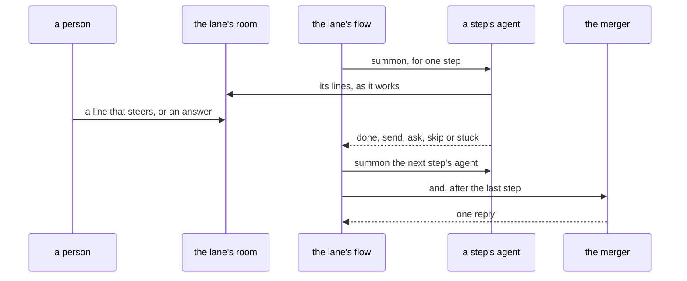

# 0158: In next/, the pipeline arrives as a lane in its room, where one flow summons each step's agent in turn and mails land at the end, built slice by slice with something a person can see after each



```text
# A sketch. The room's name and the agents' names are made up.
fabsh$ join #lane-893
#lane-893  planner: the plan is ready, with one question for a person
fabsh$ #lane-893 keep the list in the process's own storage
#lane-893  tests: 6 laws written, all red
```

**What this decides:** the shape `next/`'s pipeline takes first, and how it is built: a lane a
person can watch and talk to, grown one working slice at a time.

## Context

Today the lead session runs every lane by hand: plan, tests, build, review and landing, with scripts
on one laptop. [0078](0078-agent-and-flow-slices-start-early.md) named that cost and gave an agent
fabrika starts and a flow fabrika runs a thin slice from Tier 1. It left the shape of those slices
to the plan. The full pipeline is Tier 6 in [the tiers](../docs/plan/tiers.md).

What is decided already, and on main:

- [0073](0073-a-lane-has-a-room.md): a lane can have its own room, where a person steers its agent
  and answers an ask. It left open which tier carries the first slice.
- [0157](0157-summon-starts-an-agent-and-at-talks-to-it.md): the `summon` line is the one way to
  start an agent.
- [0064](0064-the-lead-drives-with-flows.md) and [0074](0074-agent-hands-over-a-flow.md): a flow
  holds the loop, never an agent.
- [0110](0110-merge-queue-is-fabrika-programs.md) and
  [0111](0111-merge-queue-stage-1-is-a-tier-1-row.md): landing is fabrika programs. The merger and
  the queue program are on main in `next/programs/pipeline`. Mailed `land`, the merger lands one
  change and mails back one reply.

Three first shapes were on the table:

| Shape | What it gives | What it lacks |
|---|---|---|
| Back to front: put review in front of the merger as a flow, then build, tests, plan | Each step retires one hand script | Nothing to watch or talk to until late |
| A lane in its room | Uses only decided pieces; a person watches a lane and cuts in while it runs | Waits for `summon` and rooms in `next/` |
| Wrap today's lane script as a job that reports into fabrika | Lanes show up fast | Rebuilds nothing ([rethink, do not port](../docs/direction/rethink-do-not-port.md)) |

This builds on the seven principles of [0127](0127-how-we-get-work-done-seven-principles.md) and leaves
none: code holds the edges and an agent holds the path inside one step (F7), one writer per change
(F6), and a person is asked in one place, the room (F1).

## Decision

**In `next/`, the pipeline arrives as a lane in its room, built slice by slice, and every slice ends
in something a person can see (owner, 2026-11-12).**

- A ticket's lane gets a room. It is 0073's room, with nothing added.
- One flow runs the lane. The flow holds the order of the steps; no agent holds it.
- For each step, the flow summons that step's agent into the lane's room for that one job, as a
  person's `summon` line does. The steps and their order are the glossary's. This record sets none.
- After the last step, the flow mails `land` to the merger.
- A person joins the room, reads along, steers, and answers an ask there.
- It is built on what is on main. Each slice lands whole and ends in something a person can see
  working, and the next slice starts from what that showed.
- The pieces a lane's room needs come forward. fabsh on screen, the `summon` line, `join` and rooms
  are built for it now, not when Tier 5 starts. Tiers 5 and 6 still harden agents and the pipeline,
  and their laws do not move, as 0078 has it.
- The order so far: the checklist's window is finished first
  ([0137](0137-tier-1s-program-is-the-checklist.md)), then fabsh on screen, then `summon` and
  `join`, then the lane's room.

**Binding constraints:**

- No slice of this ends with nothing to look at. Its plan names what a person sees at the end.
- A lane's flow uses the decided pieces. It adds no second way to start an agent, no second way to
  land a change and no second place to answer an ask.
- No agent approves a pull request, and no agent answers an ask put to a person, in a room as
  anywhere ([AGENTS.md](../AGENTS.md#running-the-machine-on-a-real-ticket), 0073).

## Consequences

- [The tiers](../docs/plan/tiers.md) get a dated line. No tier table row moves.
- [Summon guidelines](../docs/direction/summon-guidelines.md) said its proposed parts are walked
  when Tier 5 starts. They are walked as each slice needs them. Its decided parts hold.
- 0073's open point, which tier carries the first slice, is answered: the slices come forward as
  above.
- Cost: work moves ahead of Tiers 5 and 6. By the tier rules, a tier that grows too big splits.
- Nothing new must be recorded from day one. 0073 lists what a room line and an answer record, and
  0074 lists what a flow records.

**Not decided here:**

- What a person sees at the end of the first slice. Three ideas are on the table: a lane's steps as
  a list that ticks itself, one agent in a lane's room with no steps yet, and the merger's replies
  shown in a room.
- Whether a step's agent that needs its own box fits the `summon` line as it stands, and where that
  agent runs. The laptop is the default, as 0078 says.
- How a lane's flow is written down, in fabsh or as data. 0074 leaves the data's shape open, and
  this record does not close it.
- Everything 0073 left open: how a room line is matched to an ask, the room's name and lifetime,
  and how a step listens to its room.
