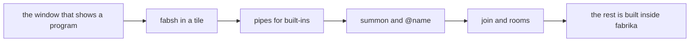

# 0159: The next thing built in next/ is the four primitives, fabsh, pipes, summon and join, working for real with whatever they need, so fabrika is built inside fabrika, never thin slices of them behind the rest of Tier 1



```text
A sketch: the lines this scope makes work. The verb `join` is still a lean in the summon guidelines.
fabsh$ a | b                                   a pipe: what a puts out is mailed to b (0109)
fabsh$ summon claude haiku as scout
fabsh$ @scout what changed in next/ yesterday?
fabsh$ join #bug-17
fabsh$ #bug-17 @scout here is the failing run
```

**What this decides:** the next thing built in `next/` is the four primitives, `fabsh`, pipes,
`summon` and `join`, working for real with everything they need, and the plan changes so this
comes first.

## Context

[The tiers](../docs/plan/tiers.md) order the work by layer and by tier. `fabsh` and pipes are in
Tier 2, agents in Tier 5, and no tier names rooms. [0068](0068-tiers-carry-every-part.md),
[0078](0078-agent-and-flow-slices-start-early.md) and [0088](0088-six-slices-in-tier-1.md) give
each core idea a thin slice in Tier 1 and leave the real build to those later tiers.

That order kept the daily use far away. On 2026-11-12, 21 of Tier 1's 44 rows had merged, and a
person could still not type a line, start an agent or talk to one in `next/`. One read of Tier 1's
rows that day (an agent's read, not a measurement) found 12 of 43 needed to run two programs
joined by a pipe on one laptop, and 22 that such a run does not need: the cloud, recovery, a second
person, chaos, quotas, the merge queue.

The owner's ruling, over 2026-11-12 and 2026-11-13: the designs are right and the order is wrong.
The goal is to build fabrika with fabrika every day, so the first thing on screen is the shell, an
agent to talk to in it, and a room to work in together. On 2026-11-12 the owner also picked that
the checklist's window ([0137](0137-tier-1s-program-is-the-checklist.md)) finishes first, since
`fabsh`'s view needs the same parts.

This record amends 0068, 0078 and 0088 in part. The thin slices they ask for are not the target
for these four primitives. Their other slices (hands, programs written outside fabrika, a flow fabrika
runs) are not changed here. It also amends
[0279](0279-tuval-is-a-package-desk-in-tier-2.md) in its timing only: a second tile and its keys no
longer wait for Tier 2. That the desk is a program stands.

## Decision

**The next thing built in `next/` is the four primitives, `fabsh`, pipes, `summon` and `join`,
working for real, with whatever they need.**

- **Done is the four primitives themselves, and everything under them.**
  - `fabsh`: a regular program in a tile that takes a line.
  - Pipes: `a | b` in a `fabsh` line, shell writing over saved program mail
    ([0109](0109-a-pipe-is-saved-program-mail.md)).
  - `summon`: starts an agent under a name, and `@name` talks to it
    ([0157](0157-summon-starts-an-agent-and-at-talks-to-it.md)).
  - `join`: puts a person in a room with people and agents
    ([summon guidelines](../docs/direction/summon-guidelines.md#rooms-mentions-and-turns-in-order),
    [0158](0158-no-dms-only-rooms.md)).
- **For real, never a thin slice.** Each works well enough to be used every day to build fabrika.
- **Whatever they need is in scope,** from whatever tier the plan had it in: the window that shows
  a program, a second tile and the keys to move between tiles, the link to the agent harnesses,
  rooms.
- **The order:** the window, then `fabsh` on screen, then pipes, working first for `fabsh`'s
  built-ins, then `summon` and `join`.
- **A program with its own React view is not part of done.** The tracker and the ticket page are
  the first work after it, built inside fabrika.
- **The purpose is the test.** Once this works, the next work is built inside fabrika, by talking
  to a summoned agent there.
- **Tier 1 changes to enable this.** The rows this scope needs come first. The rows it does not
  need wait. Nothing leaves the plan, and this file reopens no decided design.

**Binding constraints**

- A plan, a walk or a recommendation about what comes next starts from this scope, never from the
  tier a piece was in before 2026-11-13.
- No plan answers this scope with a thin slice or a stub of `fabsh`, pipes, `summon` or `join`.
- Nothing is added to done without the owner.
- A Tier 1 row this scope does not need never blocks it.

## Consequences

- [The tiers](../docs/plan/tiers.md) and [the plan](../docs/plan/README.md) get a dated line and a
  note at the top now. The changed Tier 1 (which rows come first, which wait, and what moves
  forward from Tiers 2 and 5) is its own pull request, read by the owner. Until it lands, this file
  wins where the plan files differ.
- The cost: the rows that wait land later, and work in flight on them is finished or parked by the
  changed plan, row by row. That plan says what waiting loses, if anything is lost for good.
- 0137 stands: the checklist stays the example program, and its window finishes first.
- The decided parts stay as decided: `fabsh` is a regular program, a pipe is shell writing over
  saved mail, the summon line is the one way to start an agent, every room is readable by everyone
  on the project, and the Tier 5 laws hold for any agent fabrika starts.
- Not decided here: whether the second tile arrives as the desk program or as a fixed layout
  first; what a `fabsh` line may contain beyond the lines above; the verb `join`; two agents with
  one name in a room; how a pipe carries one program's output to the next one's input;
  where a summoned agent runs (0078's default, the laptop, holds until hands say otherwise); which
  program is built first inside fabrika.

## Amendments

- 2026-11-13 (owner): no shortcut for any piece the four primitives need. Each is built the way
  its decision or note designs it, and today's version shows what working means for it. So the
  second tile comes with the desk program ([0279](0279-tuval-is-a-package-desk-in-tier-2.md)), with
  split, close and the prefix key, never a fixed layout first. That call was listed above as not
  decided.
- 2026-11-13 (lead, a narrowing of this file's own words): the bullet about a program with its own
  React view names the programs the four primitives do not need, such as the tracker and the
  ticket page. A piece the four need is in scope even when it has a view of its own: `fabsh`'s
  view, the desk, and wherever a room's talk is shown.
