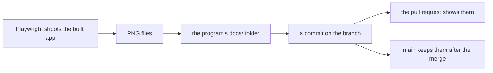
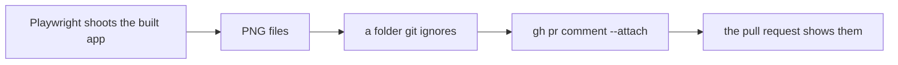

# 0160: A window pull request's shots are uploaded to the pull request with the GitHub CLI's attach flag, never committed to git

**Before:**



**After:**



```sh
# before
git add next/apps/fabrika/docs/p14/blocked.one-1440x900.dark.png
# after
gh pr comment 1028 --attach './blocked.one-1440x900.dark.png#Blocked state, one tile at 1440x900, dark'
```

The shot still reaches the pull request. It no longer passes through a commit, so main never
holds it.

**What this decides:** the shots that show a window pull request running go on the pull request
itself, and are no longer added to the repo.

## Context

- AGENTS.md's "Show it running" asked for shots saved in the program's `docs/` folder and shown in
  the PR body. On 2026-11-13 main's tree held 816 image files, 140 MB, and 815 of them sat in an
  app's or a program's `docs/` folder.
- Every clone pays for each picture from then on. A PR shot is taken to be looked at when the pull
  request is read. Ticket 898 raised it, with
  [PR 1028](https://github.com/usirin/tea-fabrika/pull/1028) and its folder of shots as the example.
- The known way: GitHub keeps a picture dragged into a comment box as an attachment, outside the
  repo. Since 2.99.0 (2026-09-01) the GitHub CLI does the same from a script, with `--attach` on
  its issue, pull request and comment commands
  ([release notes](https://github.com/cli/cli/releases/tag/v2.99.0)).
- Tried on 2026-11-13 with `gh` 2.104.0: one of PR 1028's shots,
  [posted as a comment](https://github.com/usirin/tea-fabrika/pull/1028#issuecomment-6860196328).
  GitHub stored it under `github.com/user-attachments/assets/`, and nothing was committed.
- Other ways looked at ([0040](0040-existing-tools-before-hand-written.md)):
  - An asset store with a pointer in git, as [phoenix](https://github.com/kamp-us/phoenix) has. It
    works there. This repo has no such store, and the CLI's flag needs none.
  - An extension that uploads with a browser's session cookies. It is not GitHub's own way, and it
    handles a person's login cookie.
  - A side branch that holds the pictures. That is still git, so a clone still pays.

## Decision

**A pull request that adds or changes a window shows its shots on the pull request, uploaded with
`gh`'s `--attach`, and commits none of them.**

- How shots are taken does not change: the real built app, the layouts AGENTS.md and
  [0471](0471-ui-shots-cover-eight-layouts.md) name, and each shot looked at. Only where they are
  kept changes.
- The step that shoots writes them to a folder git ignores, such as `runs/`. The lead attaches
  them, since a step's box has no login.
- They go on the pull request in a comment or in its description. Each has alt text that names its
  state and layout, written after `#` in the flag.
- The comment names the head commit the shots were taken at. Git no longer ties a shot to a
  commit, so the comment has to.
- A picture that a page on main shows, or that a test reads, is not a PR shot. It stays in git. A
  guideline page's shots ([0136](0136-guidelines-live-in-their-own-pages.md)) are the first case.

**Binding constraints**

- No pull request adds a picture to the repo only to show itself running.
- The upload is `gh`'s own `--attach`. No extension that uploads with a browser's session cookies.
- This decision removes nothing from main, and no history is rewritten.

## Consequences

- AGENTS.md's "Show it running" and the review skill's line about screenshots change in this pull
  request.
- It needs `gh` 2.99.0 or newer wherever a step attaches. The lead's laptop has 2.104.0 since
  2026-11-13.
- What it costs: a shot now lives only on GitHub's side. If its comment or its pull request is
  deleted, the picture is gone, and git history holds no copy.
- PR 1028 is open with a folder of shots. It moves them to the pull request before it lands.
- Not tried:
  - Whether the bot's token may attach. The notes of `gh` 2.103.2 say GitHub's server decides
    which app tokens may.
  - Which `gh` version CI's runners carry.
  - Until both are tried, the lead session attaches with its own login.
- Not decided:
  - The 816 pictures already on main. Some direction notes point at them.
  - Whether a shot is also copied to the owner's private archive, as
    [0027](0027-experiment-results-live-in-a-private-archive.md) does for experiment assets.
  - Whether the one place is a comment or the description.
- Ticket 898 keeps the build work: the shoot scripts write outside git, and the lane tools attach.
