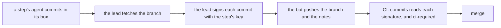
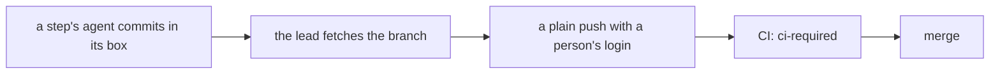

# 0161: Today's hand-run tooling makes plain commits, with no step signature and no bot, and the rule that nobody writes their own exam stays as practice until next/'s own pipeline holds it

**Before:**



**After:**



```sh
# before
sh .agents/skills/step-commit/scripts/stepcommit.sh build 828 "<subject>" <paths>
node .agents/skills/lead/scripts/botpush.mjs <tree> fabrikalfa/<branch>
# after
git commit -m "T828 build: <subject>" -- <paths>
git push origin HEAD:fabrikalfa/<branch>
```

The sign step and the bot's push are gone. Nothing else on the path moves.

**What this decides:** in the hand-run phase a commit is a plain git commit, pushed with a person's
login. No step key signs it and no bot pushes it.

## Context

- [Nobody writes their own exam](../docs/direction/nobody-writes-their-own-exam.md) was decided on
  2026-10-22: an agent that writes or fixes code never changes what that code is checked against.
- [A unit of work is a commit](../docs/direction/a-unit-of-work-is-a-commit.md) (2026-11-05) had CI
  hold that rule from signatures. Each step signs its commits with its own key, and the `commits`
  job decides from the signature. It was built for `next/` first. On 2026-11-08 today's hand-run
  tooling took signing on early.
- What it cost by hand: every commit passed through the signer on the lead's laptop, so a step's
  agent could not finish its own work. One odd state stopped a lane: a staged index, a refused
  sign, notes another session had pushed.
- On 2026-11-13, 18 pull requests were open and 7 of them were marked ready. The owner named
  merging as the thing that stops shipping.
- AGENTS.md already says a first slice does not defend against a person's own agents ("The first
  slice works, later slices harden"). The signed chain is that defense, taken on before the
  machinery that carries it.
- The bot: main's rules need it nowhere. Pull requests are already opened with a person's login,
  and no approval is required (rules read on 2026-11-13). Once signing goes, the bot's only job is
  pushing branches, which a person's login does too. The owner allowed dropping it where that
  makes the work easier, and the lead's read is that it does.

## Decision

**Today's hand-run tooling makes plain commits: no step signs them and no bot pushes them.**

- A step's work is a plain git commit. No step key, no note under `refs/notes/fabrika`, no sign at
  fetch, and no signed merge of main.
- A branch is pushed with a person's login. The `fabrikalfa/` prefix stays, since it still says the
  branch holds agent work.
- A commit's subject keeps naming its ticket and its step, as `T<ticket> <step>: <subject>` does
  today. So which step made a commit stays a recorded fact. Only the proof goes.
- CI's `commits` job stops gating a merge. `ci-required` stays.
- The rule stays, and in this phase practice holds it: tests are written before the build, by a
  different agent; the loosening check is read at the merge; and a change under an exam path still
  waits for the owner's read.
- Signing stays the design for `next/`'s own pipeline:
  [a unit of work is a commit](../docs/direction/a-unit-of-work-is-a-commit.md), decided, and
  [code commits and signs each step](../docs/direction/code-commits-and-signs-each-step.md),
  proposed. Nothing leaves the plan.

**Binding constraints**

- No hand-run script refuses a commit, a push or a merge for a missing signature.
- No agent in a box gets a login. The push stays on the host.
- The exam paths stay owner-read, and the leak grep still runs before every push.
- Old signatures and notes stay where they are. No history is rewritten.

## Consequences

- Owed, each as its own pull request:
  - CI: the `commits` workflow and the exam's commit check come out, or stop gating. They are exam
    paths, so the owner reads that pull request.
    Done 2026-11-13: the workflow came out in https://github.com/kamp-us/tea-fabrika/pull/1134.
  - Main's ruleset: `commits` leaves the required checks. That is the owner's click.
  - The lead scripts that sign or push as the bot become plain: `stepcommit.sh`,
    `box.sh fetch --sign`, `botpush.mjs`, `publish.ts`, `land.ts` and `catchup.sh`.
  - The skills that describe signing (lead, step-commit, tests, build) lose that prose in the same
    pull requests.
- Until those land, the tooling still signs and the bot still pushes.
- The ruleset that keeps the bot to `fabrikalfa/` branches has no job once the bot stops pushing.
  Whether it stays is the owner's call.
- What it costs:
  - CI can no longer prove that a builder left the exam alone. A builder that edits a law is caught
    by the loosening check or by a reader, or not at all.
  - Pushed agent work shows under a person's login on the code host.
- Amended in part:
  - [0056](0056-lead-runs-a-refused-step-itself.md): a refused lead sign no longer comes up. The
    rest holds.
  - [0098](0098-the-signed-chain-covers-the-branch-not-main.md): the chain it describes is no
    longer made by hand. It holds wherever signing runs.
  - [0116](0116-github-requires-ci-required-on-main.md): `commits` is no longer required beside
    `ci-required`. The rest holds.
- Not decided:
  - Whether a cheap code check stands in for the proof in this phase.
  - Which author name a commit of agent work carries.
  - The four steps and the field rows that each pull request goes through.
  - A merge queue for this repo.
