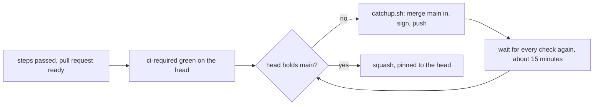
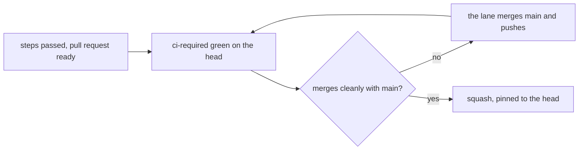

# 0162: A pull request whose steps passed lands on green CI and a clean leak check alone, with no wait, re-run, signature or script of ours in between

**Before:**



**After:**



```sh
# before (0146)
sh .agents/skills/lead/scripts/catchup.sh <pr> <ticket>
# after
gh pr merge <pr> --squash --match-head-commit <sha>
```

What moves: the loop that merged main in and ran every check again is gone. A green head that
merges cleanly lands as it is.

**What this decides:** what may stand between a finished pull request and main, and that this repo
may move to an organization to use GitHub's merge queue.

## Context

- On 2026-11-13, 18 pull requests were open and 7 were marked ready. The owner named merging as
  the thing that stops shipping, and [0161](0161-no-step-signing-by-hand.md) took step signing and
  the bot off the path the same day.
- What still stood on the path after 0161:
  - [0146](0146-a-pull-request-lands-only-on-ci-that-saw-main.md): a head that lacks main is caught
    up and every check runs again, about 15 minutes a round. It was made on 2026-11-12, after pull
    requests 1058 and 1031, each green alone, merged 19 minutes apart and left main red for 47
    minutes.
  - [0156](0156-a-batch-lands-on-one-check-run.md): a trial that lands a batch on one check run, to
    win back some of 0146's cost.
  - The lead's landing scripts, `catchup.sh` first among them, as the one way to merge
    ([0014](0014-the-lead-merges-when-every-step-passed.md),
    [0116](0116-github-requires-ci-required-on-main.md)).
  - A lane stopped by its budget waits for a person
    ([0076](0076-a-lane-stops-at-its-budget.md)).
    [0096](0096-the-lead-fixes-forward-while-the-owner-is-away.md) lets the lead answer only while
    the owner is away.
- [0107](0107-fabrika-provides-the-merge-queue.md) records the owner's ruling of 2026-11-11 that
  this repo does not move to an organization to get GitHub's merge queue, which GitHub does not
  offer to a repo owned by a personal account
  ([0049](0049-merge-behind-main-once-lint-passes-on-the-true-merge.md)).
- On 2026-11-13 the owner ruled that every piece of friction between a ticket and its merge goes,
  and allowed the move to an organization where GitHub's queue gets changes merged sooner.

This supersedes 0146 and 0156. It amends in part 0014, 0049, 0096, 0107 and 0116; each bullet
below says which part.

## Decision

**Once a pull request's steps have passed, nothing stands between it and main except green CI and
a clean leak check (owner, 2026-11-13).**

**The owner's own rulings:**

- The principle above. A wait, a re-run, a signature or a script that only our tooling asks for is
  friction, and it goes.
- Step signing and the bot are gone (0161).
- This repo may move to an organization to use GitHub's merge queue. This replaces 0107's "this
  repo stays where it is". GitHub's queue is the stopgap. fabrika's own queue stays the design, as
  0107, [0110](0110-merge-queue-is-fabrika-programs.md) and
  [0111](0111-merge-queue-stage-1-is-a-tier-1-row.md) have it.

**The lead's reading of the principle.** The lead told the owner each of these on 2026-11-13 and
the owner did not object. They are not the owner's words, and the owner may take any of them back.

- **0146's loop goes.** A pull request whose required check is green on its head, and whose head
  merges cleanly with main, lands behind main. The lint on the true merge that 0049 asked for does
  not come back.
- **0156's batch has no job left.** It shared one check run among pull requests that each needed
  one on current main. None needs that now.
- **The lead's landing scripts go.** A pull request lands by a push, green CI, and
  `gh pr merge --squash`, pinned to the head that was checked. 0014's rule of when the lead merges
  stands; its "with `catchup.sh`" does not. 0116's "`catchup.sh` keeps its own wait for the checks"
  does not either: GitHub's required check is the guard.
- **The lead answers a lane's budget stop at any time,** not only while the owner is away. 0096's
  rules for that answer stand, and so does its list of what is the owner's alone.

**From when.** Main's ruleset stopped requiring `commits` on 2026-11-13 (0161 listed that as
owed; the lead made the edit on the owner's word,
[0163](0163-the-lead-acts-on-the-owners-word.md)). It now requires `ci-required` alone, so an
unsigned commit can merge and the rules above hold from that day.

**Binding constraints**

- `ci-required` is green on the exact head that merges, and the head stays pinned (0049).
- The leak check runs before every push and on a pull request's words, and fails closed.
- No force push, no `--admin`, no auto-merge, no override flag.
- A change under an exam path waits for the owner's read, and the loosening check is read at the
  merge (0161).
- The four steps, plan, tests, build and review, are not changed here.
- Main's ruleset changes and the repo transfers only on the owner's word (0116). The lead may be
  the hands when the owner tells it to
  ([0163](0163-the-lead-acts-on-the-owners-word.md)); no other agent may.

## Consequences

- **The cost, said plainly:** two pull requests that pass alone and break together can turn main
  red again, as on 2026-11-12. The lead fixes main the same hour. Once GitHub's queue is on, it
  tests each change on current main before it lands, and this risk closes again.
- What `catchup.sh` did after a merge is the lead's by hand until code takes it: closing the
  tickets the description names ([0015](0015-a-pr-phrase-closes-its-tickets.md)) and kicking the
  box cleanup ([0101](0101-box-cleanup-runs-on-a-timer.md)).
- 0156's trial ends. Any numbers it produced still go in `experiments/`.
- Owed for the move, each as its own pull request:
  - CI: `check.yaml` gets the `merge_group` trigger, and `.github/ci/changes.mjs` runs every job on
    it, as on a push to main. No workflow has that trigger today. These are exam paths, so the
    owner reads it.
  - After the transfer: the two places that hold this repo's address as config,
    `programs/tracker/src/github.ts` and the leak check's allowed URL in `leakgrep.sh`.
  - The prose that names `catchup.sh` as the way to merge: `AGENTS.md`, the plan's "How a change
    lands" and the lead skill.
- How sure the lead is that the move pays: about 80%. The doubt is what a transfer carries.
  GitHub's docs offer the queue to
  [a public repo owned by an organization](https://docs.github.com/en/repositories/configuring-branches-and-other-settings-on-github/configuring-pull-request-merges/managing-a-merge-queue),
  and do not say whether rulesets come along. Both are checked right after the transfer.
- With a queue on, `gh pr merge` adds a green pull request to the queue and arms auto-merge on one
  that is not green yet. The lead runs it only once the checks are green.
- Not decided here:
  - whether field rows and plan rows ([0013](0013-plan-docs-change-with-the-work.md)) may trail a
    merge by a day;
  - the four steps and the draft pull request at the first commit
    ([0134](0134-no-code-stays-only-on-a-local-branch.md));
  - the settings of GitHub's queue, and when fabrika's own queue takes over from it.

## Amendments

- 2026-11-13: a record of what was set, not a new ruling. On the owner's word of 2026-11-13, the
  ruleset "main only through a pull request" gained GitHub's `merge_queue` rule, so main now takes
  changes only through GitHub's merge queue. Its settings as read that day: the merge method is
  squash; a group holds one pull request (at least 1 and at most 1 to merge, with no wait for
  more); up to 3 groups build at once; every group must be green (`ALLGREEN`); a group's checks
  have 60 minutes to answer; and `ci-required` is the one required check. The squash commit takes
  the pull request's title and description as its title and message. The repo's Actions allow list
  gained `merge_group`, and `check.yaml` runs on it. This settles the first half of "the settings
  of GitHub's queue" under "Not decided here"; when fabrika's own queue takes over stays open.
