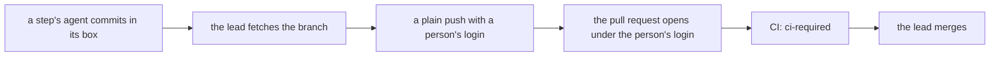
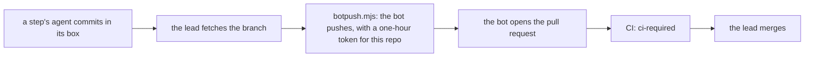

# 0164: The bot pushes agent branches and opens their pull requests, with no step signature and the owner as co-author, and a step's agent stays in its box

**Before (0161):**



**After:**



```sh
# before (0161): a person's login pushes and opens
git commit -m "T828 build: <subject>" -- <paths>
git push origin HEAD:fabrikalfa/<branch>
gh pr create --head fabrikalfa/<branch>

# after: the tooling writes these, nobody types them, and nothing is signed
git -c user.name='fabrikalfa[bot]' commit -m "T828 build: <subject>" -m "Co-authored-by: <the owner>" -- <paths>
node .agents/skills/lead/scripts/botpush.mjs <tree> fabrikalfa/<branch>
```

What moves: who pushes and who opens the pull request. The box, the fetch, CI and the merge stay
where they are, and no sign step comes back.

**What this decides:** whose identity carries agent work to the code host in today's hand-run
tooling, and that a step's agent keeps running in a box.

## Context

- [0161](0161-no-step-signing-by-hand.md) dropped two things on 2026-11-13: the step signature and
  the bot. The owner had allowed dropping the bot where that made the work easier, and the lead read
  it that way.
- The same day this repo moved to an organization
  ([0162](0162-no-friction-before-a-merge.md)). The owner's own login reaches other repos in that
  organization too, and 0161's plain push uses that login for every push of agent work.
- The bot's token is smaller. `botpush.mjs` asks for one that names this one repo
  (`.agents/skills/lead/scripts/botpush.mjs:100`), and GitHub ends it after one hour.
- The bot was already the decided identity for agent work:
  [0401](0401-agents-commit-as-the-fabrikalfa-bot.md) (the bot authors, the person is co-author),
  [0405](0405-pull-requests-open-as-person-or-bot.md) (a pull request opens as the person or as the
  bot, by a setting), [0406](0406-the-bot-is-held-to-its-branches.md) (the repo's rules hold the bot
  to `fabrikalfa/` branches) and
  [0407](0407-this-repos-agent-commits-are-the-bots.md) (every agent commit in this repo, the
  lead's included). 0161 left those four unmarked while it said the opposite for the hand-run
  phase.
- What made a lane slow was the signature and the loop that ran every check again on newest main.
  Both are gone (0161, 0162). The box was never the slow part: getting work out of it is one fetch
  that code runs.
- A box keeps a step's agent away from every real key
  ([programs run in a box](../docs/direction/programs-run-in-a-box.md),
  [0045](0045-test-steps-run-in-containers.md)). A step's agent runs install scripts and tests it
  did not write, so it is the last place a login should be in reach.

This amends 0161 in part: its "no bot" half goes, and its "no step signature" half stands. It
amends 0162 in part: "the bot is gone" no longer holds, and the push in its landing line is the
bot's. It amends 0407 in part: pull requests now open as the bot. 0401, 0405 and 0406 hold as
written, in the hand-run tooling again.

## Decision

**The bot pushes agent branches and opens their pull requests. Nothing is signed, the owner rides
as co-author, and boxes stay (owner, 2026-11-13).**

- **Commits.** A commit of agent work is authored by `fabrikalfa[bot]` and names the owner in git's
  own `Co-authored-by` trailer, as 0401 and 0407 say. The tooling writes both lines.
- **No signature.** No step key signs a commit, and no note goes under `refs/notes/fabrika`. That
  half of 0161 stands, with its rule that practice holds "nobody writes their own exam" for now.
- **Pushes.** A `fabrikalfa/` branch is pushed by the bot, with a token that lasts one hour.
- **Pull requests.** The bot opens them. This is 0405's setting, set to "as the bot" for this repo.
- **Boxes stay.** A step's agent runs in its box and holds no login for the code host. 0161's
  constraint stands: no agent in a box gets a login, and the push stays on the host.
- **How a push leaves a box.**
  [0403](0403-a-stand-in-token-in-the-box.md) stays the design: the box holds a stand-in token and a
  proxy at its edge swaps it for the real one. The hand-run tooling has no such proxy today (read
  2026-11-13). Until it does, the lead's code fetches the branch from the box and runs the bot's
  push on the host, as one command with no person in it.
- **Merging stays the lead's act,** by 0162's rule: green `ci-required`, a clean leak check, and
  the head pinned.

**Binding constraints**

- The leak check runs before every push, on the branch's net change and on each commit the push
  sends ([0048](0048-leak-check-reads-each-commit.md)), and fails closed.
- No force push, no `--admin`, no auto-merge.
- The bot's token is never printed, never written to disk, and never passed into a box in the
  clear. The app's key stays outside every box.
- No tooling uses the bot's token to merge.
- No hand-run script refuses a commit or a push for a missing signature (0161).

## Consequences

- **Owed, each as its own change:**
  - Done 2026-11-13: the owner installed the app on the organization, for all its repos, by the
    owner's own choice. `botpush.mjs` looks the installation up by repo (`botpush.mjs:95`).
  - `botpush.mjs` stops needing step notes. Today it refuses a tree with no `refs/notes/fabrika`
    (`botpush.mjs:62` to `64`) and pushes the notes with every branch (`botpush.mjs:124`).
  - A pull request opened as the bot. Today every path opens one with `gh pr create` under a
    person's login (`flow/landing.ts:173`, `land.ts:502`, `pr/PullRequestsGh.ts:88`, all under
    `.agents/skills/lead/scripts/`), and the bot's token asks only for `contents` and `workflows`
    (`botpush.mjs:101`). The app holds GitHub's `pull_requests` permission (read 2026-11-13); the
    token must ask for it too.
  - The ruleset that keeps the bot to `fabrikalfa/` branches, turned back on with admins exempt.
    The transfer emptied its bypass list, so it refused every push outside `fabrikalfa/` and was
    turned off on 2026-11-13. The lead changes it on the owner's word (0163), and 0406 says what it
    must hold.
  - A commit path that writes the bot as author and the co-author trailer with no signature. The
    trailer is written by code already (`.agents/skills/step-commit/scripts/stepcommit.sh:162`,
    `land.ts:339`, `catchup.sh:499`, from `FABRIKA_COAUTHOR` in `env.sh:12`), but
    `stepcommit.sh` signs in the same run.
- **The cost:** one more moving part on every push. A push now needs the app installed, its key
  in the laptop's keychain and GitHub's token service answering.
- **Already answered elsewhere, and in force again:** the lead's own commits are the bot's too
  (0407), and the author of a change a model wrote is the bot (0401). 0161 listed the author's name
  as not decided; for agent work it is decided.
- Not decided here:
  - Whether a docs pull request that only records a decision may still be pushed with the owner's
    login when the bot cannot push.
  - Whether the commit also names the model that wrote it. 0401 says the agent never names itself
    and leaves the trailer keys open.
  - When 0403's proxy is built for the hand-run tooling, and what it lets a box ask the code host
    to do.
  - Whether main asks for an approving review, now that the bot opens pull requests and a person
    could approve them.
