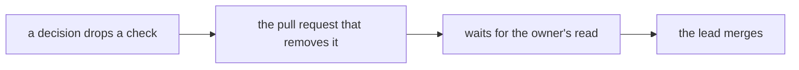
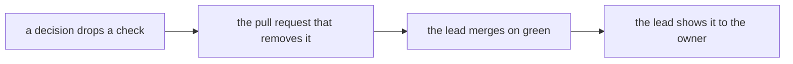

# 0166: A pull request that only carries out what an accepted decision already owes merges without the owner's read, exam paths included, and the lead shows it to the owner after

**Before:**



**After:**



```text
0161, owed:  "the commits workflow comes out ... the owner reads that pull request"
now:         the lead merges it on green, then shows the owner what merged
```

**What this decides:** who has to look, and when, at a pull request that removes or changes a check
because an accepted decision already said so.

## Context

- [0161](0161-no-step-signing-by-hand.md) dropped step signing on 2026-11-13. It listed the removal
  of CI's `commits` workflow as owed, and added that the owner reads that pull request, because the
  workflow is an exam path.
- Until that pull request merged, the `commits` check failed on every pull request. It was not
  required, so it blocked nothing, but every pull request showed a red mark that meant nothing.
- The owner had already made the call in 0161. The second read asked for the same yes again, and
  the wait kept the red marks in place.
- [0014](0014-the-lead-merges-when-every-step-passed.md) lets the lead merge any pull request once
  its steps passed, and holds back only real loosening of a law or a new design call.
  [0163](0163-the-lead-acts-on-the-owners-word.md) lets the lead act on the owner's word.

This amends 0161 in part: its "the owner reads that pull request" goes. It narrows 0014's hold on
loosening: a loosening that an accepted decision asked for is no longer held.

## Decision

**A pull request that only carries out what an accepted decision already owes needs no owner read
before it merges. The lead merges it and shows it to the owner after (owner, 2026-11-13).**

- **What counts.** The change is named by an accepted decision: as an owed item, or as the plain
  result of what it decided. Taking out a check, a workflow, a law or a script that the decision
  dropped counts, on an exam path too.
- **What the lead still does.** Green `ci-required`, a clean leak check on the diff and on the
  title and description, and the `loosening.sh` output in the pull request. Each law taken out is
  listed with the decision that dropped it.
- **Shown after.** The lead tells the owner what merged, with the link, the same day. The owner can
  ask for it back.
- **Fast track.** Such a pull request does not wait behind other work.
- **Still the owner's, before the merge:** a loosening that no accepted decision asked for, a new
  design call, and a change to a GitHub or security setting (0163).

**Binding constraints**

- The pull request does only the owed thing. A second change riding along is judged by its own
  rule.
- The decision it carries out is linked in the description.
- No force push, no `--admin`, no auto-merge.

## Consequences

- The `commits` workflow's removal merges on green, and so does the retirement of the lead's
  catch-up script, which the merge queue replaced
  ([0162](0162-no-friction-before-a-merge.md)).
- **The cost:** one fewer pair of eyes before an exam path changes. What keeps it honest is that
  the owner made the call once already, in a decision file, and sees the result the same day.
- `AGENTS.md` says so where it says what waits on the owner.
- Not decided here:
  - Whether the lead may read "the plain result of what it decided" widely. When in doubt, it is a
    new design call and goes to the owner.
  - How the owner is shown what merged once the status page moves into the app.
