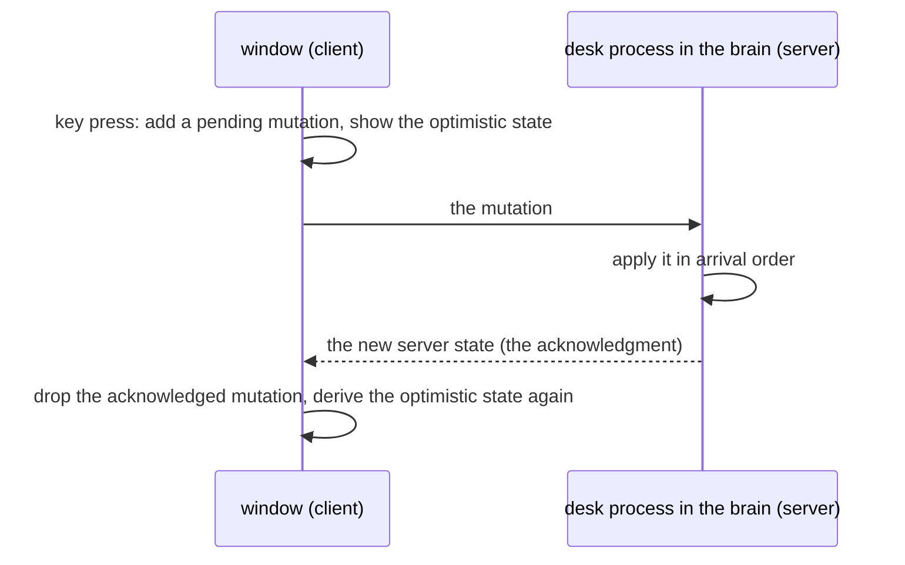

# 0167: In next/, a window applies a focus or cursor change at once as an optimistic update, and the desk process in the brain is authoritative



```ts
// A sketch, not the shape: the window's side.
const Model = Schema.Struct({
  workspace: Schema.Int, // the number of the one it shows
  serverState: Workspace,
  pendingMutations: Schema.Array(Mutation),
});

// What the window draws: the server state with its own pending mutations on top.
const optimisticState = (m: Model) =>
  m.pendingMutations.reduce(apply, m.serverState);
```

**What this decides:** who moves focus first when a person presses a key, the window or the brain,
and whose state is the truth.

## Context

- The desk's state, layout and focus, is a process in the brain
  ([0274](0274-the-desktop-is-a-platform-free-core.md)). A workspace has one focus, and two windows
  on one workspace mirror ([0277](0277-size-belongs-to-the-viewer.md)). Each tile keeps a cursor
  ([0165](0165-a-tile-keeps-its-cursor.md)).
- A window is a client: the app's own window, or a browser tab
  ([a browser is always a client](../docs/direction/a-browser-is-always-a-client.md)). The brain
  can be on another machine.
- If every focus move waited for the brain's answer, each key press would be as slow as the
  network. Focus is the one thing a person on a keyboard feels on every press.
- The record held nothing on a client acting before the brain answers.
  [A local-first sync engine](../docs/direction/a-local-first-sync-engine.md) decided "central
  first", and its local-first part is a vision, not planned.

The industry's names are used as they are: optimistic update, server state, pending mutation,
acknowledgment, server-authoritative.

## Decision

**A window applies a focus or cursor change at once and sends it to the desk process. The desk
process is authoritative: its state is the truth, and the window follows it (owner, 2026-11-13).**

- **Optimistic, for two things only:** which tile has focus, and a tile's cursor.
- **The window keeps three things:** the workspace it shows, the server state it last received,
  and its own pending mutations. What it draws is the optimistic state: the server state with the
  pending mutations applied on top.
- **The server applies mutations in the order they arrive** and sends its new state. The window
  drops each mutation the server has answered and derives the optimistic state again. If another
  window got there first, the window's focus follows the server.
- **Each mutation says which window sent it,** so the record can tell who moved focus.
- **Everything else waits for the server:** layout changes (split, close, fold, move), starting a
  process, and anything that changes what a tile shows.

**Binding constraints**

- The window never treats its optimistic state as the truth: it stores the server state and its
  pending mutations apart, and derives the rest.
- The optimistic state is derived, never stored.
- No design asks the server to trust a window's clock to order two mutations
  (`arrivedAt`, not `sentAt`).

## Consequences

- Focus moves on the key press, on a slow network too.
- **The cost:** now and then focus jumps back, when two windows on one workspace move it at the
  same moment and the other one arrived first.
- The window's side is a tea machine with this Model
  ([0046](0046-one-tea-machine-per-file.md)).
- The glossary gains `optimistic state`, `pending mutation` and `server state`, under Frame.
- Not decided here:
  - How the server's answer is matched to a pending mutation (an id per mutation, or a count).
  - What a person sees or hears when focus jumps back, a screen reader included.
  - Whether a window that is offline keeps its pending mutations or drops them.
  - Who keeps a tile's cursor, the desk or the program (left open by 0165).
  - How a focus move fits [0278](0278-each-window-runs-its-own-prefix.md), where each window runs its own prefix.
