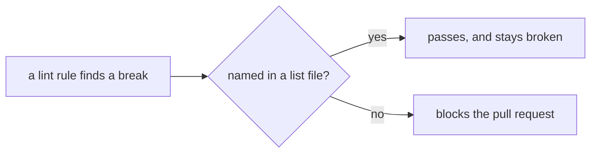
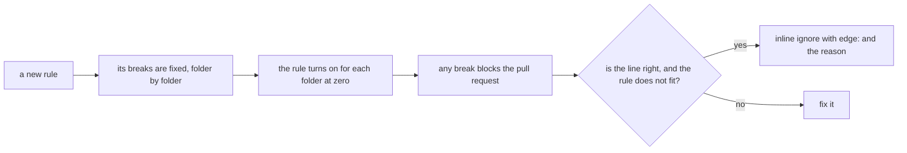

# 0168: An old lint break is fixed, never kept in a list file and never marked as debt, and a new rule turns on where its breaks are at zero

**Before:**



**After:**



```ts
// before: wrong, and waved through by a row in next-ledger.json
afterEach(async () => {
  await server.close();
});

// after: fixed, as 0061 asks
const server = Effect.acquireRelease(open, close);

// unchanged: the one inline ignore, for a line that is right where the rule does not fit
// oxlint-disable-next-line fabrika/no-promises -- edge: the platform hands back a Promise
```

**What this decides:** what happens to a known lint break. It is fixed. It is not kept in a list
file, and it is not marked on its line as debt.

## Context

- [0033](0033-agents-code-follows-next-rules.md) gave lead tooling a list file of old breaks that
  only shrinks, `agents-ledger.json`, and `next-ledger.json` does the same for `next/`. On
  2026-11-13 they held 113 and 115 entries.
- Experiment 282, the Effect guidelines audit
  ([pull request 1129](https://github.com/kamp-us/tea-fabrika/pull/1129)), found that no Effect
  guideline has a whole check. Each new rule would have started with a large first entry in a
  list file.
- A list file lets broken code pass and hides that from the person reading it. Marking each break
  on its line would show it, but would still leave it broken. `next/` is the foundation the rest
  is built on, so the breaks are fixed.
- `AGENTS.md` already has the inline form for a line that is right:
  `// oxlint-disable-next-line <rule> -- <why>`, and edges are marked the same way. That stays.

This supersedes the list-file half of 0033: its rule that `.agents/` code follows `next/`'s rules
stands.

## Decision

**A known lint break is fixed. No lint rule keeps a list file of known breaks, no line is marked
as debt, and a new rule turns on where its breaks are at zero (owner, 2026-11-13).**

- **The lists are worked down to zero.** The breaks named in `next-ledger.json` and
  `agents-ledger.json` are fixed, rule by rule. Each file is deleted, with the code that reads it,
  when it is empty. Until then they only shrink, as before.
- **No new entry, ever.** No pull request adds a row to either file.
- **A new rule starts at zero.** Its breaks are fixed first. Where that is too much for one pull
  request, the rule turns on folder by folder, each folder when it reaches zero, so the gate
  closes behind the work.
- **code-graph's list stays.** `unreachable-ledger.json`, the list for exports nobody uses, is
  how code-graph works, so it is kept ([0006](0006-no-unused-exports.md)). It still only shrinks.
- **One inline ignore stays:** `edge:`, for a line that is right where the rule does not fit, with
  its reason. It is not a way to postpone a fix.
- **Fast track.** A pull request that fixes listed breaks carries out this decision, so it merges
  on green and is shown to the owner after ([0166](0166-owed-work-needs-no-owner-read.md)). It
  changes no law: same assertions, same generators.

**Binding constraints**

- A fix does not weaken the rule, narrow its paths or switch it off.
- A break in a script that an open pull request deletes is not fixed first; the deletion removes
  it.

## Consequences

- Every rule that is on holds everywhere it is on. Nothing passes because a file says so.
- **The cost:** real work before a rule can block. On 2026-11-13 that is 228 listed breaks, most
  of them in test files: 71 imports across layers, 50 Promises, 43 `afterEach` hooks.
- The plan for the docs rule (experiment 282's E6) changes: the missing doc blocks are written
  first, and the rule turns on folder by folder.
- `AGENTS.md`'s lines about a list that only shrinks go when the files go.
- Not decided here:
  - `compiler-ledger.json`, empty today, whose rows
    [0464](0464-every-compiler-finding-fails-the-build.md) asks the owner to approve.
