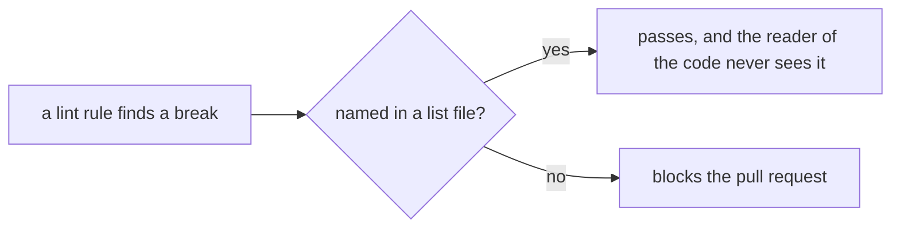
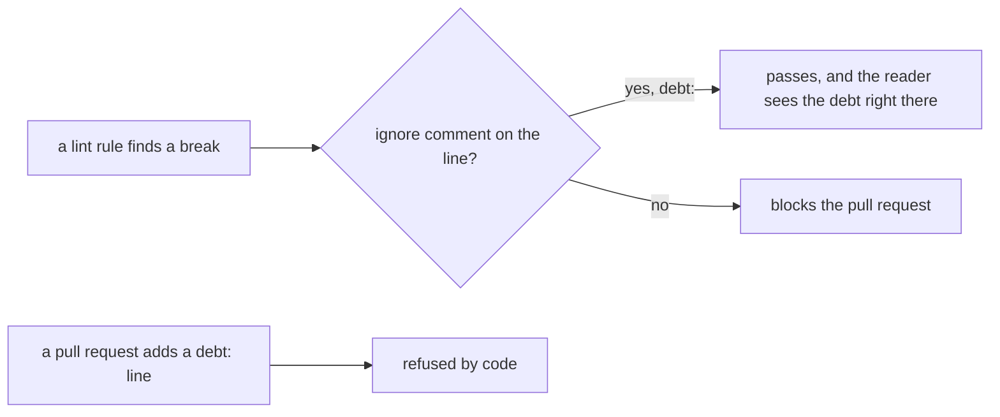

# 0168: An old lint break is marked on its own line with an inline ignore, and no lint rule keeps a list file of known breaks

**Before:**



**After:**



```ts
// before: the break is named far away, in next-ledger.json
import { Lease } from "./Lease.ts";

// after: the break is marked where it is
// oxlint-disable-next-line no-restricted-imports -- debt: here before the rule
import { Lease } from "./Lease.ts";

// unchanged: a line that is right, where the rule does not fit
// oxlint-disable-next-line fabrika/no-promises -- edge: the platform hands back a Promise
```

**What this decides:** where a known, not yet fixed lint break is written down: on its own line,
never in a list file.

## Context

- [0033](0033-agents-code-follows-next-rules.md) gave lead tooling a list file of old breaks that
  only shrinks, `agents-ledger.json`, and `next-ledger.json` does the same for `next/`. On
  2026-11-13 they held 113 and 115 entries.
- Experiment 282, the Effect guidelines audit
  ([pull request 1129](https://github.com/kamp-us/tea-fabrika/pull/1129)), found that no Effect guideline
  has a whole check. Each new rule would have started with a large first entry in the list file,
  and the rule that these files never gain entries stood in the way.
- A list file hides the debt from the person reading the code. It is also one shared file that
  many branches change at once, so it conflicts.
- `AGENTS.md` already has the inline form for a line that is right:
  `// oxlint-disable-next-line <rule> -- <why>`, and edges are marked the same way.

This supersedes the list-file half of 0033: its rule that `.agents/` code follows `next/`'s rules
stands.

## Decision

**A known lint break is marked on its own line with an inline ignore whose reason starts with
`debt:`. No lint rule keeps a list file of known breaks, and the ones here are converted and
deleted (owner, 2026-11-13).**

- **Two reasons, two words.** `edge:` says the line is right and the rule does not fit. `debt:`
  says the line is wrong, known, and not fixed yet.
- **The files go.** `next-ledger.json` and `agents-ledger.json` are converted, entry by entry, to
  `debt:` lines, and deleted with the code that read them.
- **Nobody adds debt.** Code refuses a pull request that adds a `debt:` line. The only way the
  count moves is down.
- **A new rule starts clean where it can.** Its breaks are fixed first and the rule turns on at
  zero. Where that is too much for one pull request, the rule's own first pull request writes the
  `debt:` lines, and that is the one time the count may rise.
- **Fixing removes the line.** A fix deletes the `debt:` comment in the same change. oxlint
  reports an ignore that no longer ignores anything.
- **Fast track.** The conversion carries out this decision, so it merges on green and is shown to
  the owner after ([0166](0166-owed-work-needs-no-owner-read.md)).

**Binding constraints**

- A `debt:` line names one rule. No file-wide and no folder-wide ignore stands in for it.
- The check that refuses a new `debt:` line is code, with its edge cases listed and tested
  ([0040](0040-existing-tools-before-hand-written.md)).
- The conversion changes comments only. It fixes no break and changes no rule.

## Consequences

- A reader of a file sees its debt. `rg "debt:"` counts all of it.
- **The cost:** one comment line per old break lands in the code until the break is fixed.
- The plan for the docs rule (experiment 282's E6) changes: the missing doc blocks are written first, and the rule turns on at zero.
- `AGENTS.md`'s lines about a list that only shrinks change with the conversion.
- Not decided here:
  - `unreachable-ledger.json`, the list for exports nobody uses. That check is code-graph's, not
    oxlint's, so it goes inline only if code-graph can read a marker on the line. To be checked.
  - `compiler-ledger.json`, empty today, whose rows
    [0464](0464-every-compiler-finding-fails-the-build.md) asks the owner to approve.
  - The exact code that refuses a new `debt:` line: a lint rule cannot see a diff, so it reads the
    change against main.
