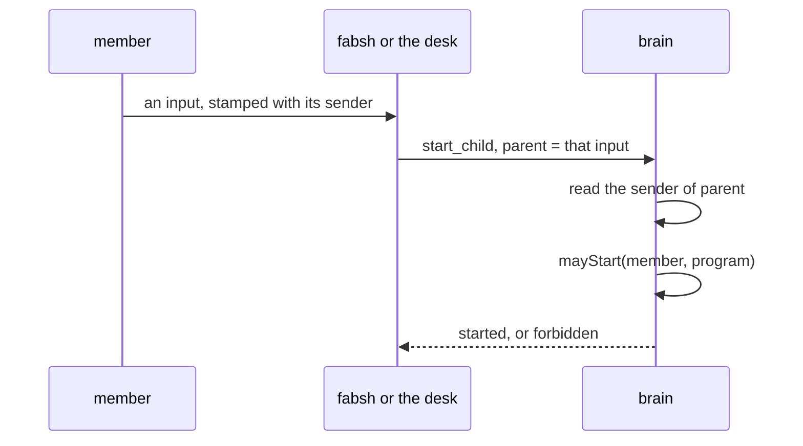

# 0170: In next/, a start is checked against the member whose input caused it from the first slice, fabsh and the desk hold no permission of their own, and the first rule lets any member start any program



```ts
// A sketch, not the shape. `Senders`, `Member` and `mayStart` are made-up names.
// `Child`, `From`, `ChildrenError` and `forbidden` are today's, in `processes/Children.ts`.

// The first rule: any member may start any program. A smarter rule changes only this line.
const mayStart = (_member: Member, _program: string): boolean => true;

const check = Effect.fn("children.check")(function* (child: Child, from: From) {
  const senders = yield* Senders;
  // A start is a write, so `from.parent` is the input that caused it (0262).
  const member = yield* senders.sender(from.parent);
  if (!mayStart(member, child.code.program)) {
    return yield* new ChildrenError({ reason: "forbidden" });
  }
});
```

**What this decides:** who the brain checks when a program asks it to start another program: the
member whose input caused the start, never the program that asked.

## Context

The owner decided this for `next/` on 2026-11-13.

What `next/` does today:

- A program asks the brain for a start with the built-in `start_child`
  (`next/packages/libfabrika/src/runtime/StartChild.ts:33`). Its refusals include `forbidden`
  (`StartChild.ts:18`).
- The check is program to program. A `StartGrant` says a process of one program may start a process
  of another (`next/packages/libfabrika/src/processes/Children.ts:17`). The brain asks
  `granted(requester's program, child's program)`
  (`next/packages/libfabrika/src/processes/ChildrenLedger.ts:78`).
- The list comes from the instance's `starts` setting (`next/apps/fabrika/src/settings.ts:16`) and
  is empty by default (`next/apps/fabrika/src/runtime.ts:37`).
- A start keeps its `requester`, but only as a process (`Children.ts:27`). For a typed line that is
  the shell's process, not the member who typed it.
- A letter into a program already records `by`, who wrote it, with `parent` and `traceId`
  (`next/packages/libfabrika/src/processes/Mailbox.ts:22-30`). So the member is on record one step
  before the start, and lost at the start.

Two programs sit in front of nearly every start:

- **The desk.** `open` is OTP's `whereis` then `start_child`, in one step
  (`docs/direction/program-guidelines.md:226`). The desk then monitors the process a tile shows, and
  the tile follows its `keep` (`docs/direction/the-desktop-layer.md:98-104`).
- **`fabsh`.** It is a regular program in a tile that takes a line
  (`.decisions/0159-fabsh-pipes-summon-join-first.md:64`, and the `fabsh` row in
  `.glossary/TERMS.md`). A line that runs a program is a start.

`summon` is not a third starter of programs. It brings an agent onto the desk under a name, and its
glossary row says "Not starting a program" (`.glossary/TERMS.md`, row `summon`).

With a program-to-program list, those two programs would need a grant for every program there is.
The cloud, invites and agents as teammates come right after the four primitives
([0159](0159-fabsh-pipes-summon-join-first.md)), so the question "may this member start this?" is
close.

It builds on:

- [0261](0261-inputs-carry-their-sender.md): every input carries its sender, stamped at the gateway,
  and every write carries the input that caused it.
- [0262](0262-a-write-carries-parent-and-traceid.md): a write carries `parent`, whose sender signs,
  and `traceId`, which only explains.
- [0263](0263-a-writes-signer-is-its-causes-sender.md): the law that every write an input from
  sender S causes is signed S.
- [0290](0290-one-owner-admins-and-members.md): a shared fabrika has one owner, admins and members.

The known way: Unix checks the user a process runs as, never the shell that called `exec`. The
shell holds no right of its own. A program trusted because every request passes through it is the
confused deputy problem
([Hardy, 1988](https://dl.acm.org/doi/10.1145/54289.871709)).

## Decision

**A start is checked against the member whose input caused it, from the first slice.**

- A `start_child` is a write. By 0261 and 0262 it belongs to the sender of the input that caused it.
  The brain checks that member.
- `fabsh` and the desk hold no start permission of their own. There is no wildcard grant for them.
- The first rule is the plain one: any member may start any program. A member here is anyone in the
  shared fabrika, whatever the role in 0290.
- The check and its protocol exist from day one. Only the rule is simple. A smarter rule later
  changes the rule, never the protocol.
- It does not wait for a later hardening pass. This is the standing rule applied: "A v0 has no
  missing parts: quick means each part is small, never absent" (`AGENTS.md`).

**Words**

- **permission** is what a member may do.
- **grant** is one entry in a list.
- `source` pairs with `target`, as decision 0169 says. It is in
  [pull request 1140](https://github.com/kamp-us/tea-fabrika/pull/1140), still open on this date.

**Binding constraints**

- No program is trusted to start others because of which program it is.
- A start's answer and refusals keep their shape when the rule changes.

**Weighed and dropped**

- A wildcard grant for `fabsh` and the desk. The brain would check nothing for the two programs
  every start goes through, and it would be redone when invites land.
- A generated list with one grant per installed program. It must be rewritten on every install, and
  it can go stale.

## Consequences

- The start has to carry its cause to the brain, so the brain can read the sender. Today it carries
  only the requester's process.
- The cost is one lookup per start, the same one a write already pays for its signer (0262).
- A program that drops the cause of a start gets a wrong member checked, not an error. 0263's law is
  the kind of check that catches it.
- The glossary gets two rows, `permission` and `grant`.

**Not decided here:**

- Who a start belongs to when no member's input is behind it: a supervisor's restart, a scheduled
  job, a start at boot. [0140](0140-gateway-refuses-client-id-and-by.md) makes a write with no cause
  `own`; whether a start follows it is open.
- Who is checked when the input came from an agent working for a person: the agent, the person, or
  both.
- What becomes of today's program-to-program list, the instance's `starts` setting.
- What a person sees when a start is refused.
- Any role finer than owner, admin and member. 0290 leaves those for later.

## Records

- `.glossary/TERMS.md`, Clients: the rows `permission` and `grant`.
