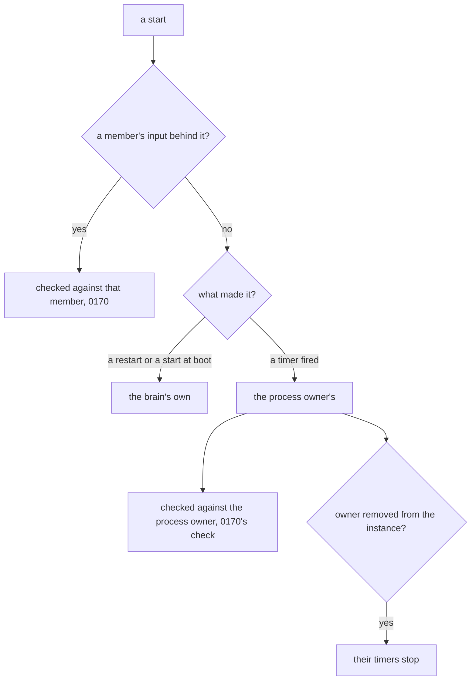

# 0172: In next/, a start with no member's input behind it is the brain's own when it is a restart or a start at boot and the process owner's when a timer fires it, a process keeps the member whose input started it, and that member's timers stop when the member is removed



```ts
// Today, next/packages/libfabrika/src/runtime/Program.ts:352. `caused` and `own` are today's
// names; a naming decision is coming separately.
export const Write = Schema.TaggedUnion({
  caused: { parent: ParentText, event: Event },
  own: { event: Event },
});

// A sketch, not the shape. `Member`, `Unprompted`, `Party` and `party` are made-up names.
const Unprompted = Schema.Literals(["restart", "boot", "timer"]);
const Party = Schema.TaggedUnion({ brain: {}, member: { member: Member } });

// Who a start with no member's input behind it belongs to. `owner` is the member the process keeps.
const party = (start: typeof Unprompted.Type, owner: typeof Member.Type): typeof Party.Type =>
  start === "timer" ? Party.cases.member.make({ member: owner }) : Party.cases.brain.make({});
```

**What this decides:** who a start belongs to when no member's input caused it, and who a timer's
start is checked against.

## Context

The owner decided this for `next/` on 2026-11-13.

It answers one item that
[0170](0170-a-start-is-checked-against-its-sender.md) left under "Not decided here": who a start
belongs to when no member's input is behind it, which it lists as "a supervisor's restart, a
scheduled job, a start at boot". 0170 is in
[pull request 1142](https://github.com/kamp-us/tea-fabrika/pull/1142), still open on this date.

What is settled already:

- [0261](0261-inputs-carry-their-sender.md): every input carries its sender, and every write carries
  the input that caused it. It also says "One owner per job, one signer per write".
- [0262](0262-a-write-carries-parent-and-traceid.md): a write carries `parent`, and its sender signs.
- [0263](0263-a-writes-signer-is-its-causes-sender.md): the law that every write an input from
  sender S causes is signed S.
- [0140](0140-gateway-refuses-client-id-and-by.md): a write with no cause is the owner's own, `own`.
- 0170: a start is a write, and it is checked against the member whose input caused it.

What `next/` does today:

- A program asks for a write with or without a cause: `Write` has the cases `caused` and `own`
  (`next/packages/libfabrika/src/runtime/Program.ts:352-355`). Those are today's names.
- Every line the brain's `ProcessManager` writes carries the brain's own key as `by`. The caller who
  asked is kept apart, as `asked` (`.glossary/TERMS.md`, rows `by` and `asked (body key)`).
- A start keeps its `requester`, but only as a process
  (`next/packages/libfabrika/src/processes/Children.ts:27`). No process keeps a member today.

The known way: on Unix, a deleted user's cron jobs stop running. `userdel` runs a command that
"should remove any at/cron/print jobs etc. owned by the user to be removed"
([login.defs(5), `USERDEL_CMD`](https://man7.org/linux/man-pages/man5/login.defs.5.html)).

## Decision

**A start with no member's input behind it belongs to the brain or to the process owner.**

- A restart or a start at boot is the brain's own. The brain's process manager already writes those
  lines `by` the brain's key.
- A start a timer fires is the process owner's. This is 0140 applied to starts: a write with no cause
  is the process's own.
- A process keeps the member who owns it: the member whose input started it. That is the member a
  timer's start is checked against, with 0170's check.
- When that member is removed from the instance, their timers stop.

**Words**

- **process owner** is the member a process keeps: the member whose input started it. Unix says the
  same: a process's owner is the user it runs as.

## Consequences

- A process has to record its owner when it starts. Today a start records only the process that
  asked.
- A timer's start goes through the same check as a typed one, so it needs no rule of its own.
- The glossary gets one row, `process owner`.

**Not decided here:**

- What happens to a removed member's running processes and their saved state.
- Who may take those processes over.
- Who owns a process the brain starts at boot.
- Whether a restarted process, which is a new process, keeps the owner of the one it replaces.
- The names of the `Write` union's cases. A naming decision is coming separately. This file says
  `caused` and `own` only because the code does today.

## Records

- `.glossary/TERMS.md`, Runtime: the row `process owner`.
