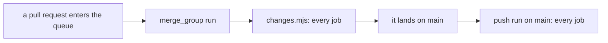
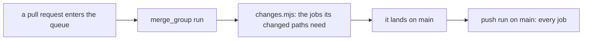

# 0174: A merge queue's run starts only the checks its changed files need, never every check for a small change

**Before (0162):**



**After:**



```js
// before: .github/ci/changes.mjs, classify
if (event !== "pull_request" || paths === null || paths.length === 0) return { ...all };

// after
const scoped = (event) => event === "pull_request" || event === "merge_group";
if (!scoped(event) || paths === null || paths.length === 0) return { ...all };
```

What moves: the queue's run. A pull request's run and main's run stay as they were.

**What this decides:** which jobs of `check.yaml` a merge queue's run starts.

## Context

- [0162](0162-no-friction-before-a-merge.md) listed the CI work owed for the move to GitHub's merge
  queue. Its line said `.github/ci/changes.mjs` runs every job on `merge_group`, as on a push to
  main. Commit 9276a9606 built that.
- Measured on 2026-11-13: every queue entry started all 18 jobs of `check.yaml`, a one-file
  decision included.
- This amends that one line of 0162 (its lines 133 to 135). The owner called that line wrong.

## Decision

**A merge queue's run picks its jobs from its changed paths, exactly as a ready pull request does.**

- The group's changed paths are the diff from `merge_group.base_sha`, the commit the group was built
  on, to the group's head.
- A group is never a draft. The draft rule stays for `pull_request` alone.
- Every push to main still runs every job, so a break shows up right after the merge.
- A faster queue is worth an occasional red main: fabrika is still a research project and is not in
  production.

## Consequences

- A queue entry of Markdown alone starts no heavy job. One of `next/` files alone skips `test` and
  `e2e`.
- The cost: a change that passes its own jobs and breaks a job the queue skipped turns main red.
  Main's run after the merge shows it, and the lead fixes main.
- Two laws in `.github/ci/changes.test.ts` are narrower for `merge_group` and whole for `push`. That
  narrowing is the owner's call, made with this decision.
- `ci-required` needs no change: it passes a skipped job when `changes` said "false" for it, on any
  event.

## Not decided

- Nothing else in 0162 changes.
