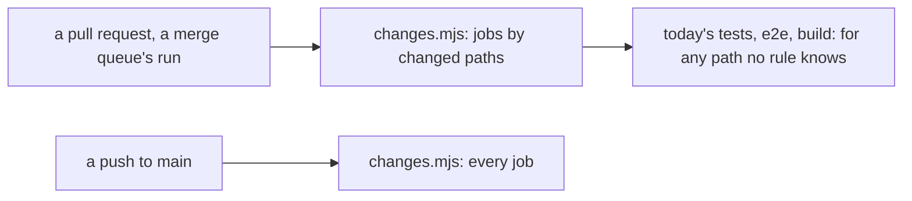
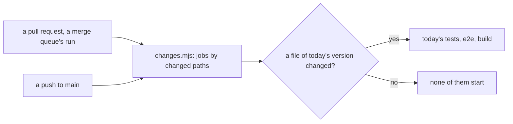

# 0175: Every run that can read its changed paths picks its jobs from them, a push to main included, and today's version's checks start only when one of its files changed

**Before (0174):**



**After:**



```text
# node .github/ci/changes.mjs with EVENT=push
# one decision file          # next/ files alone          # a packages/ file
# before    after            # before    after            # before    after
check=true  false            check=true  true             check=true  true
typecheck=true  false        typecheck=true  true         typecheck=true  true
test=true   false            test=true   false            test=true   true
next=true   false            next=true   true             next=true   false
e2e=true    false            e2e=true    false            e2e=true    true
build=true  false            build=true  false            build=true  true
            today=false                  today=false                  today=true
```

What moves: a push to main joins the two events that already follow their paths, and today's tests,
`e2e` and the build leave every run that touched none of today's files.

**What this decides:** which jobs of `check.yaml` a run starts, on every event.

## Context

- [0174](0174-a-queue-run-follows-its-paths.md) made a merge queue's run follow its changed paths,
  and kept one line: every push to main still runs every job. This replaces that line.
- The owner's principle, stated for all CI: a run starts only the checks related to its change,
  never every check for a one-line change.
- Today's version is being replaced by `next/`
  ([clean slate](../docs/direction/clean-slate.md)). Its code rarely changes, and a faster queue
  matters more than checking again code nobody touched.

## Decision

**Every event that can read its changed paths picks its jobs from them: a pull request, a merge
queue's run and a push to main. Today's version's checks start only when one of its files changed.**

- A push's changed paths are the diff from what main held before the push to its head.
- A push is never a draft. The draft rule stays for `pull_request` alone.
- Today's checks are: today's tests in the `test` job, the `e2e` job, and the slow half of `check`,
  its promises gate and `pnpm build`.
- A file of today's version is one under `apps/`, `programs/`, `packs/`, `wip/`, `legacy/`,
  `packages/` or `fixtures/`, less plain Markdown no check reads.
- A file that reruns every test, such as the lockfile, a root `package.json` or a tsconfig, is not
  one. It starts none of today's checks.
- The tooling tests are the tests of neither version's product code: CI's own, the lint plugins, the
  root scripts and the skill scripts. When the `test` job starts with no file of today's version
  changed, it runs them alone, and only the ones that reach the change.
- A run that cannot say what changed runs everything: history that cannot be read, no path at all,
  a first push with no commit before it, and any event that is none of the three.

## Consequences

- The `changes` job gives one more output, `today`. The `test` job runs today's tests when it is
  true and the tooling tests alone when it is false. Its base for vitest's `--changed` now comes
  from the merge queue's group and the push too, so neither runs a whole suite.
- **The cost, said plainly:** nothing runs the whole suite any more, on a schedule or after a
  merge. A change whose effect falls outside its own kind of path is caught only when someone next
  touches that area. For today's app that means a shared dependency or a root config can break it
  with CI green.
- The laws in `.github/ci/changes.test.ts` that said a push runs every job, and that a shared path
  or a skill path starts `e2e` and the build, are narrower. That narrowing is the owner's call, made
  with this decision.
- `ci-required` needs no change: it passes a skipped job when `changes` said "false" for it.

## Not decided

- A scheduled run of the whole suite.
- Nothing about deleting today's version.
- Nothing about `next/`'s own checks.
