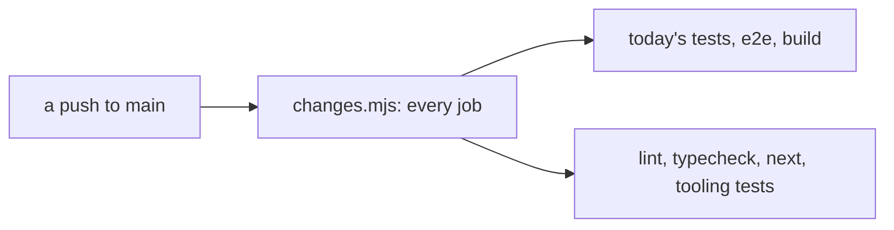
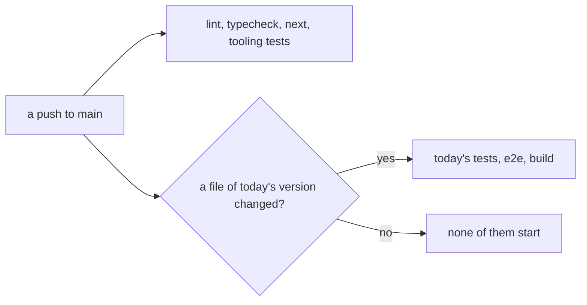

# 0175: Today's version's checks start only when one of its files changed, on every event, and a push to main still runs every next/ check

**Before (0174):**



**After:**



```text
# node .github/ci/changes.mjs, a push whose diff is next/ files alone
# before                      # after
check=true                    check=true
typecheck=true                typecheck=true
test=true                     test=true      (the tooling tests alone)
next=true                     next=true
e2e=true                      e2e=false
build=true                    build=false
                              today=false
```

What moves: today's tests, `e2e` and the build leave every run that touched none of today's files.
The same rule holds on a pull request and in the merge queue.

**What this decides:** when CI starts the checks that belong to today's version.

## Context

- [0174](0174-a-queue-run-follows-its-paths.md) made a merge queue's run follow its changed paths,
  and kept one line: every push to main still runs every job. This amends that line.
- The owner's principle from 0174 decides the details: a run starts only the checks related to its
  change.
- Today's version is being replaced by `next/`
  ([clean slate](../docs/direction/clean-slate.md)). Its code rarely changes, and a faster queue
  matters more than checking again code nobody touched.

## Decision

**Today's version's checks start only when the run's changed paths hold one of its files, on a pull
request, in the merge queue and on a push to main.**

- Today's checks are: today's tests in the `test` job, the `e2e` job, and the slow half of `check`,
  its promises gate and `pnpm build`.
- A file of today's version is one under `apps/`, `programs/`, `packs/`, `wip/`, `legacy/`,
  `packages/` or `fixtures/`, less plain Markdown no check reads.
- A file that reruns every test, such as the lockfile, a root `package.json` or a tsconfig, is not
  one. It starts none of today's checks.
- A push to main still runs lint, typecheck and every `next` shard, so a break in `next/` shows
  right after the merge. Lint and typecheck cover the whole repo.
- The tooling tests are the tests of neither version's product code: CI's own, the lint plugins, the
  root scripts and the skill scripts. They run on every push to main and when a pull request or a
  queue's run touches what they read, without today's packages' tests beside them.
- History that cannot be read still runs everything.

## Consequences

- The `changes` job gives one more output, `today`. The `test` job runs today's tests when it is
  true and the tooling tests alone when it is false.
- **The cost, said plainly:** a change outside today's folders that breaks today's app, such as a
  shared dependency or a root config, is no longer caught by CI. It shows when someone next runs or
  changes today's version.
- The laws in `.github/ci/changes.test.ts` that said a push, a shared path or a skill path starts
  `e2e` and the build are narrower. That narrowing is the owner's call, made with this decision.
- `ci-required` needs no change: it passes a skipped job when `changes` said "false" for it.

## Not decided

- Nothing about deleting today's version.
- Nothing about `next/`'s own checks.
