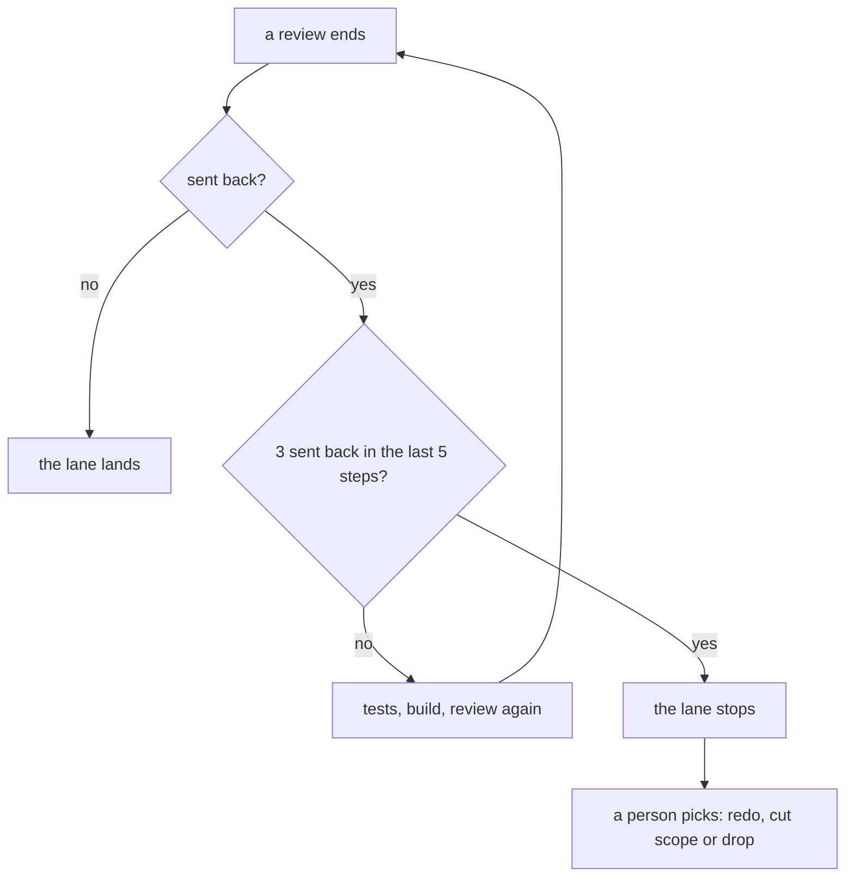
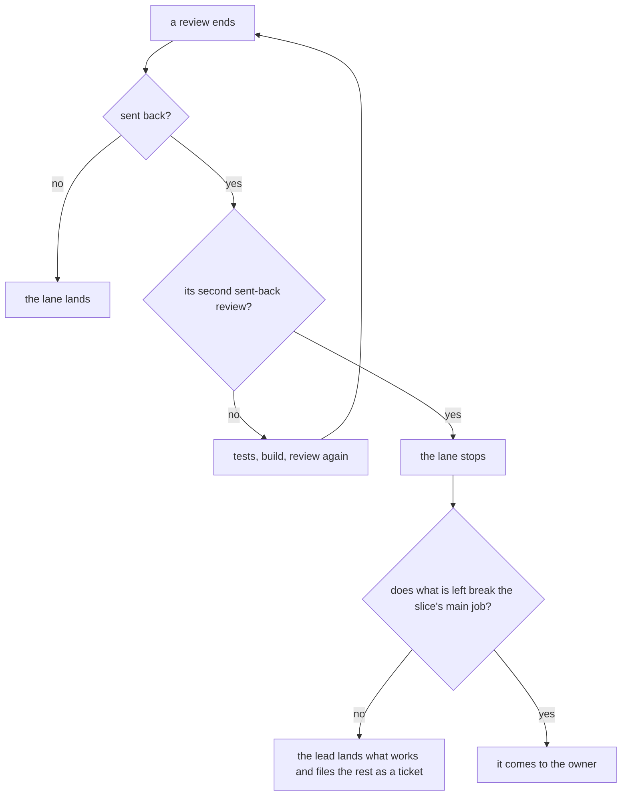

# 0176: A lane stops at its second sent-back review, and the lead lands what works and files the rest as a ticket, unless what is left breaks the slice's main job

**What this decides:** a lane stops the second time a review sends it back, and the lead then lands
the part that works and files the rest as a ticket, going to the owner only when the rest breaks the
slice's main job.

**Before** ([0076](0076-a-lane-stops-at-its-budget.md)):



**After:**



```ts
// Sketch, not built.
// before: 0076's window. On the usual loop it never fires.
const intensity = { count: 3, within: 5 }; // work stucks or sends in the last 5 steps
// after: sent-back reviews are counted, over the lane.
const stop = { sentBackReviews: 2 };
```

Two things move: what is counted, and who answers the stop.

## Context

**0076's window cannot fire on the usual loop.** The loop is review, tests, build, review. Any 5
steps in a row hold at most 2 send-backs, and the window needs 3.

**What that let through.** Counted on 2026-11-13 from the lanes' own step records, as reviews that
sent the lane back out of reviews held, on five open lanes:

| Pull request | Reviews that sent it back | Reviews held |
|---|---|---|
| [1012](https://github.com/kamp-us/tea-fabrika/pull/1012) | 12 | 24 |
| [1028](https://github.com/kamp-us/tea-fabrika/pull/1028) | 12 | 17 |
| [1079](https://github.com/kamp-us/tea-fabrika/pull/1079) | at least 8 | 11 |
| [1032](https://github.com/kamp-us/tea-fabrika/pull/1032) | 7 | 10 |
| [1099](https://github.com/kamp-us/tea-fabrika/pull/1099) | 7 | 7 |

**0076's other stop was not applied either.** That stop is twice the plan's estimate, in steps and
dollars. The lanes are run by hand since the pipeline programs were paused, and nothing counted.

**How it fits older decisions.**

- It amends [0076](0076-a-lane-stops-at-its-budget.md) in two places. Its window, 3 work stucks or
  send-backs within the last 5 steps, no longer decides for sent-back reviews: the second one stops
  the lane. Its stop that asks a person one of three things changes for this case: the lead picks
  cutting scope by default.
- The rest of 0076 stands: the fault on a stuck step, the finding row for a tool stuck, and the
  backstop in steps and dollars.
- [0072](0072-a-churning-lane-is-redone.md) stays the other choice: when what works is not worth
  landing, the lane is redone on a fresh branch.

## Decision

**A lane stops at its second sent-back review; the lead's default is then to land what works and
file the rest as a ticket; and it comes to the owner only when what is left breaks the slice's main
job (owner, 2026-11-13).**

- A lane stops at its second sent-back review. Sent-back reviews are what is counted, not 3 of the
  last 5 steps.
- When it stops, the lead's default is to land what works and file the rest as a ticket.
- It comes to the owner only when what is left breaks the slice's main job.

## Consequences

- A lane stops much earlier. The five lanes above would each have stopped at their second sent-back
  review.
- **The cost:** more known rough edges sit on main as tickets.
- **The number 2 is a starting point, not a measured one.** What would settle it is the share of
  merged lanes that passed by their second review. Nobody has counted that yet.
- Not decided here:
  - how the count is kept while lanes run by hand; today the lead counts it and shows it on its
    status page;
  - what "breaks the slice's main job" means, beyond the lead's judgment;
  - whether the number stays 2.
