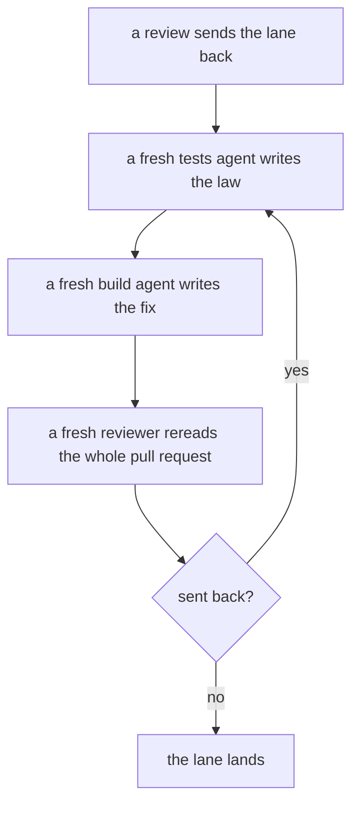
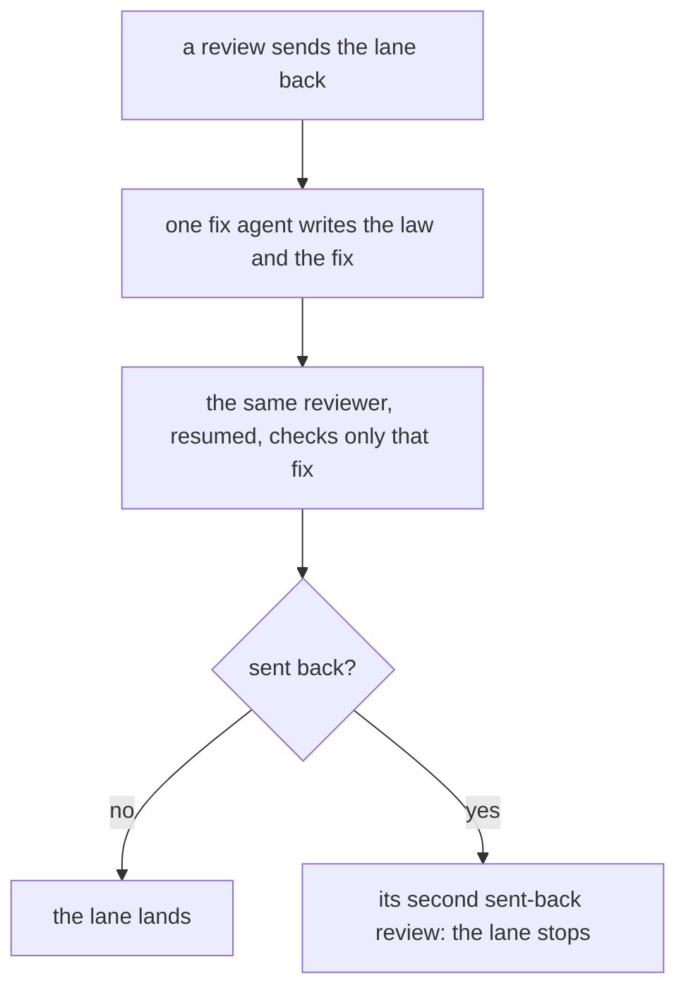

# 0177: After a review sends a lane back, one fix agent writes the law and the fix together, and the same reviewer is resumed to check only that fix

**What this decides:** a fault a review sends back is fixed by one agent, which writes the test and
the fix together, and the reviewer that found it is resumed to check only that fix.

**Before:**



**After:**



```text
# before: three briefs, three fresh agents
Use the tests skill for ticket 277. This round: a law for the fault at door.ts:41.
Use the build skill for ticket 277. This round: make that law green.
Use the review skill for ticket 277. Reviewed head: <sha>.   (a new reviewer, the whole diff)
# after: one brief, then one message to the reviewer that is already there
Fix round for ticket 277. Fault: door.ts:41, shown by <input>. Write the law and the fix together.
Recheck for ticket 277. New head: <sha>. Check the fix for the faults you named.
```

Three fresh agents become one, and the reviewer is not started again from nothing. The first pass
does not move.

## Context

- A lane's first pass is plan, tests, build and one review, each by its own fresh agent
  ([the steps](../docs/direction/next-is-a-pipeline-pre-run.md)). A sent-back fault went through
  the same steps again.
- **What that cost.** Measured on 2026-11-13: one sent-back fault cost three or four fresh agent
  runs (tests, build, and a new reviewer rereading the whole pull request), round after round. Five
  open lanes had between 7 and 12 sent-back reviews each
  ([0176](0176-second-send-back-stops-lane.md) has the numbers).
- **The known way.** In ordinary code review the author fixes the comment, and the same reviewer
  rechecks the fix.
- **How it fits older decisions.**
  - It amends [0161](0161-no-step-signing-by-hand.md) in one place. 0161 kept "nobody writes their
    own exam" as practice: tests are written before the build, by a different agent. That no
    longer holds on a fix round. The rest of 0161 stands.
  - [0176](0176-second-send-back-stops-lane.md) says where the loop ends: the second sent-back
    review stops the lane.
  - [0066](0066-mutation-runs-on-a-schedule.md) stands: the hourly mutation run on main is one of
    the two guards left on a fix round's test.

## Decision

**After a review sends a lane back, one fix agent writes the law and the fix together, and the same
reviewer is resumed, with what it already read, to check only that fix (owner, 2026-11-13).**

- One fix agent writes the law (the test) and the fix together. A fix round has no separate tests
  step and build step.
- The same reviewer is resumed, with what it already read. It checks only that fix.
- If it sends the lane back again, that is the second sent-back review, and the lane stops
  ([0176](0176-second-send-back-stops-lane.md)).
- The first pass is unchanged: plan, tests, build, one review, each by its own fresh agent.
- A review that answers `send plan` is not a fix round. It goes back to the plan step, as today.

## Consequences

- A sent-back fault costs one fresh agent run and one resumed reviewer, where it cost three or
  four fresh runs.
- **What this gives up:** on a fix round the fixer writes its own test. So "nobody writes their own
  exam" does not hold for fix rounds.
- **What still guards it:**
  - the reviewer reads that test on its recheck;
  - the hourly mutation run on main hunts weak tests
    ([0066](0066-mutation-runs-on-a-schedule.md)).
- The lead skill holds the fix agent's brief and the recheck message. The review, tests and build
  skills each say their part.
- `chain.ts` still sends a fault back through tests, build and a fresh review. Until it changes,
  the lead runs a fix round by hand.
- Not decided:
  - what a fix round looks like in `next/`'s own pipeline programs;
  - whether a fix that changes the plan, a new design call, still goes back to the plan step. It
    does today.
