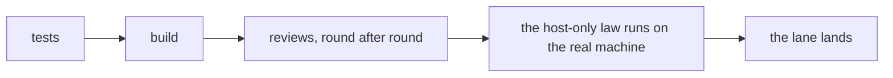
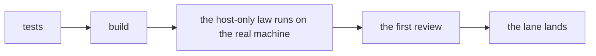

# 0178: A law that can only run on the real machine runs before the first review, and a build is not done until that law has passed there

**What this decides:** a test that needs the real machine (launchd, the real Electron app, a real
OS process or socket) is run right after the build, before any review starts, and never at the end
of the lane.

**Before:**



**After:**



```text
# Sketch of a plan's line for one law, not a checked format.
# before
the service starts under launchd: scenario, run by the lead before the merge
# after
the service starts under launchd: scenario, host-only, run by the build before the first review
```

The host run moves from the end of the lane to just after the build.

## Context

- Some laws cannot run in a step's box. They need a real Mac: launchd, the real Electron app, a
  real OS process or a real socket. Call such a law host-only.
- **The measured case, 2026-11-13.** P19 slice 1
  ([pull request 1079](https://github.com/kamp-us/tea-fabrika/pull/1079)) went through eleven
  reviews before its one host-only law was run. The first host run failed at once, on two faults:
  - the test's helper bundles were empty;
  - the product read macOS 14's "not loaded" output as an error, so the service could never start
    on a real Mac.
- The fixtures in its laws had been written without a real Mac's output.
- So every review before that run argued over rare edges of something that had never started.
- **How it fits older decisions.**
  - [0052](0052-tests-never-depend-on-the-machine.md) stands. A host-only law needs a real
    machine, never one person's own home folder or data.
  - [0045](0045-test-steps-run-in-containers.md) stands for a step's box. A host run is outside it.

## Decision

**A host-only law runs on the real machine before the first review, and a build is not done while
it has not passed there (owner, 2026-11-13).**

- The plan marks each host-only law as one the build step runs, or the lead runs right after the
  build, before any review starts.
- A build is not done while its host-only law has not passed on a real machine.
- A fixture that stands in for a real tool's output is taken from a real run and labeled as a
  vector.
- The owner's Mac may be used for the run. Nobody needs to ask first.

**Binding constraints.** These rules stay:

- A test window never takes focus.
- One Electron test app at a time.
- The test uses its own temp home and its own test label.
- It leaves nothing behind.

## Consequences

- The first review reads something that has started on a real machine.
- **The cost:** a build takes longer to be done, and it uses the person's machine while they may
  be working on it. The rules that stay are what keep that out of their way.
- The plan, build and lead skills each say their part.
- Not decided: how this runs in `next/`'s own pipeline. There a step runs in a container
  ([0045](0045-test-steps-run-in-containers.md)), and a host run needs the person's machine. It is
  open.

## Records

- `.glossary/TERMS.md`: a row for **host-only law**, in Pipeline.
