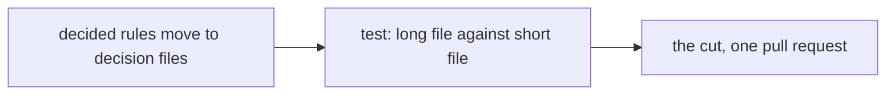
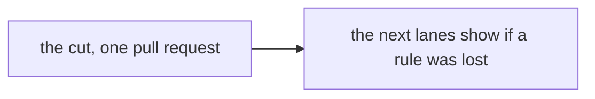

# 0180: AGENTS.md is cut to a short map with no test first, and an instruction file takes a quick edit

**Before:**

**After:**

The test leaves the path. The cut no longer waits on anything.

**What this decides:** that shortening the text agents are made to read needs no experiment before
it, and lands the way lead tooling does.

## Context

[0129](0129-agents-md-becomes-a-short-map.md) decided the short map and put one test before the
cut: the same step on the same tickets, with the long file and with a short one. It asked for the
test because no measurement showed the long file hurt. Two days later the file had grown from 685
lines to 722 and the cut had not started.

Measured on 2026-11-13: the instruction files loaded into every session take 26.6k tokens.
`AGENTS.md` is 722 lines and 58,693 bytes. `.agents/skills/lead/SKILL.md` is 766 lines. All skill
Markdown together is 2,858 lines. The `AGENTS.md` of the repo this one follows for decisions is 73
lines. The owner withdrew the test the same day and asked for an audit of every source that puts
text into an agent's context.

This amends 0129: its order is withdrawn. Its short map, its three moves and its rule that no rule
is dropped or changed still hold.

## Decision

**The cut of `AGENTS.md` lands with no test first.**

- 0129's order (decided rules move, then the test, then the cut) is withdrawn. The cut is one pull
  request, opened as soon as it is written.
- That pull request still carries 0129's table: one row per rule removed, saying where it went or
  which check holds it. It is the guard that no rule was lost.
- An edit that shortens or moves instruction text (`AGENTS.md`, a folder's `AGENTS.md`, a skill's
  prose) is lead tooling: the lead or one agent changes it directly, keeps the change small, and
  merges on green CI with a clean leak grep. It needs no plan, no experiment and no table.
- A quick edit still changes no rule. A rule that looks wrong becomes a question for the owner.
- What replaces the test: the next lanes. A rule an agent missed after the cut is put back, or
  given a better home, the day it is seen.

## Consequences

- Every agent's first read gets shorter now, not after an experiment.
- The cost: nothing compares the short file with the long one on the same tickets, so a small drop
  in quality could go unseen. Send-backs in `field/` are the only signal.
- Not decided here: the line count of the map, which folders get a file of their own, and what
  the context audit's findings turn into.
