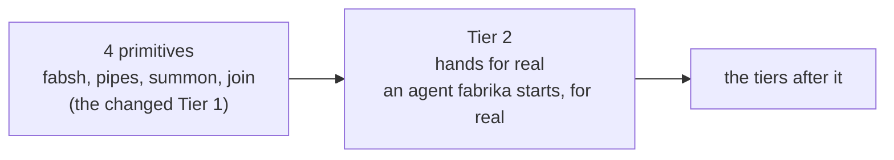

# 0185: The changed Tier 1 is the milestone named 4 primitives, and Tier 2 then builds hands and an agent fabrika starts for real, so a person runs an agent with no second thought

**What this decides:** the name of the milestone being built now, and what the next one is for.



```text
core idea                  built for real in, before   after
hands                      Tier 4                      Tier 2
an agent fabrika starts    Tier 5                      Tier 2
```

## Context

[0159](0159-fabsh-pipes-summon-join-first.md) made the four primitives the next thing built in
`next/`, and [the tiers page](../docs/plan/tiers.md) wrote that down as "the changed Tier 1". It had
no short name.

The tiers page builds hands for real in Tier 4 and an agent fabrika starts in Tier 5. Tier 1 holds
only a thin slice of each: hands far enough to run one turn
([0102](0102-hands-is-a-grant-rank-and-work-is-taken.md)), and the link to the agent harnesses that
`summon` needs. Between them and the real thing sat two tiers of other work.

The owner's reason for fabrika is to run their own agents with no second thought: start one, on
this machine or another, and not weigh the laptop's load, the setup or the cost first. Running jobs
outside our own computers, each on its person's own key, was ruled on 2026-10-25, and
[experiment 148](../experiments/148-remote-programs.md) ran it once.

## Decision

- **The milestone being built now is named "4 primitives".** It is the changed Tier 1 of 0159: the
  same pieces, the same order, the same done. Only the name is new.
- **Tier 2 is where hands and an agent fabrika starts are built for real.** They move forward from
  Tiers 4 and 5. Tier 2's plan is written for that goal: a person starts an agent run and it
  happens, with nothing to think about first.
- **It comes after the 4 primitives, never before or beside them.**
- **It comes right after them. Recovery and the other cloud rows (P26, P27, P28, P29, P36) wait
  behind Tier 2.** This amends 0159's amendment of 2026-11-13, which made those rows the first work
  after the 4 primitives. None of them leaves the plan. The owner's reason: losing the laptop in
  the coming weeks is unlikely, and the owner keeps direct access to the instance's Worker on
  Cloudflare, so its data can be reached without a recovery flow.

## Consequences

- The tiers page changes in this pull request: the name, and the two rows of its core idea table.
  Its Tier 2, Tier 4 and Tier 5 sections still show the old sorting until the Tier 2 plan is
  written.
- Until recovery lands, daily work on the laptop lives only in the laptop's ledger. The owner
  accepted that risk on 2026-11-13 for the 4 primitives, and now for Tier 2 as well.
- A Tier 2 plan is owed. It names what the old Tier 2 rows (tracker, ticket, notes, typed pipes)
  do: stay in Tier 2, or move later.
- What this cannot tell us: how big Tier 2 becomes. If it grows too big it splits, by the tiers
  page's own rules.

**Not decided here:**

- Where hands get their machine: a Cloudflare container, a Mac, a VM, or a box from the agent
  maker's own cloud sessions, which have no machine bill but draw on the person's plan. An
  experiment picks.
- When recovery and the other cloud rows are built, beyond "after Tier 2".
- What is left in Tiers 4 and 5 once this moves.

## Amendments

- 2026-11-13 (owner): Tier 2 comes right after the 4 primitives, and recovery and the other cloud
  rows (P26, P27, P28, P29, P36) wait behind it. The bullet under Decision, the line under
  Consequences and the "Not decided here" item on that order were added the same day, after this
  file first landed.
