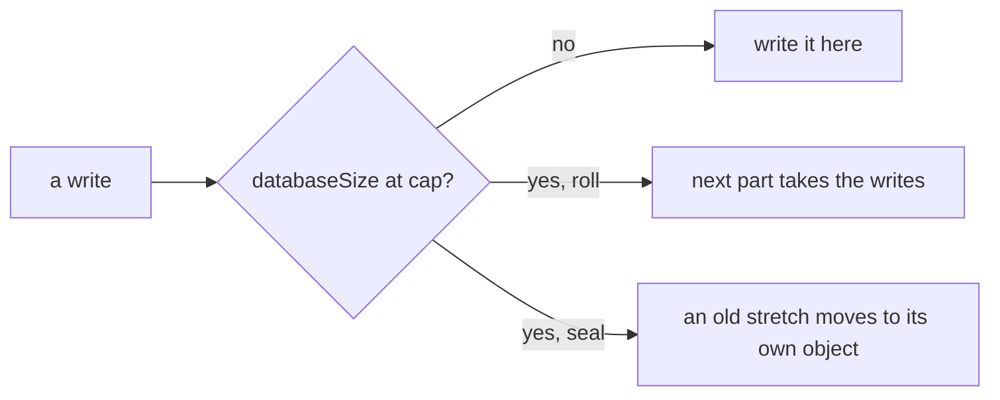

# 0200: In next/, no object grows forever, each one that grows names its cap and rolls to a new part or seals an old stretch there, and nothing is dropped to stay under it

**What this decides:** every Durable Object in `next/` that keeps growing says how big it may get
and what it does when it gets there.



```ts
// A sketch from the note. Every object that grows names its cap and what it does there.
interface Bounded {
  readonly cap: number; // bytes, read against ctx.storage.sql.databaseSize
  readonly atCap: "roll" | "seal";
}
// Never: { atCap: "drop" }.
```

## Context

One Durable Object is bounded at 10 GB, and storage across many objects is unlimited, so fabrika
is designed for that the way Elixir is designed for many small processes. The owner decided the
principle on 2026-11-07, after P37's questions. The long reasoning is in
[design for bounded objects](../docs/direction/design-for-bounded-objects.md).

## Decision

**In `next/`, no object grows forever: each one that grows names its cap and what it does at it,
and nothing is ever dropped to stay under a cap.**

- At its cap an object does one of two things: it rolls, so a new part takes the next writes, or
  it seals an old stretch into an object of its own.
- Dropping data is never one of the choices.
- A plan for a new object that grows says its cap and which of the two it does.

## Consequences

- Each cap is a guess until a real `next/` object grows past a few megabytes.
- The rolling and sealing rules for each kind of object are in
  [0204](0204-process-record-rolls-in-parts.md) and
  [0206](0206-sealed-ledger-stretches-keep-one-order.md).
