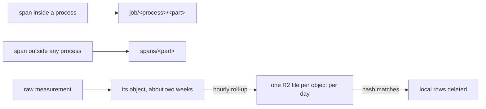

# 0202: In next/, every span and every raw measurement is kept forever, spans outside a process go to record objects of their own, and old measurements move to R2 files each object uploads itself

**What this decides:** in `next/`, no span and no raw measurement is ever deleted, and where each
one is kept.

## Context

The owner decided these on 2026-11-07, from P37's questions. R2 stores data for $0.015 per
GB-month against Durable Object storage's $0.20 (Cloudflare's pricing pages, read 2026-11-07).
See [design for bounded objects](../docs/direction/design-for-bounded-objects.md). The note says
"health rows"; [0038](0038-span-sink-measurements-and-metrics.md) renamed them measurements.

## Decision

**In `next/`, every span and every raw measurement is kept forever.**

- Spans from outside any process, such as a gateway call before a process starts, go to record
  objects of their own, in parts, as a JobRecord does. They never go into the project object.
- At the hourly roll-up, raw measurements older than about two weeks are written to one R2 file per
  object per day. Recent rows stay in the object for fast reads.
- The local rows are deleted only after the R2 file's hash matches.
- Each object uploads its own archive files. There is no shared archive object.

## Consequences

- Built in P37: `telemetry/Trace.ts` names the `job` and `spans` chains, and `telemetry/Archive.ts`
  makes the R2 calls, which fail a `put` whose body does not match its `sha256`.
- Not decided here: one R2 bucket per kind of data or one bucket with a prefix per kind. The note
  leaves that as a lean under 80%.
