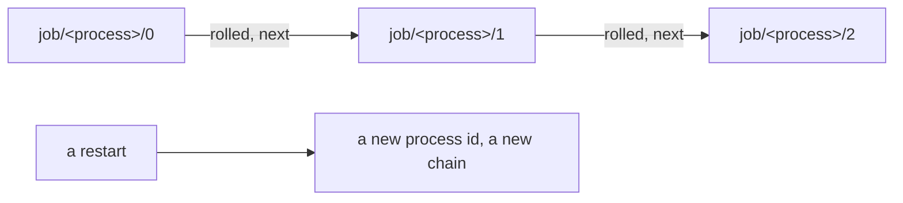

# 0204: In next/, each process keeps its spans in a JobRecord of its own, kept forever, that rolls to a new part at its cap, and a restart is a new process with a new record

**What this decides:** where a `next/` process's spans live, and what happens when that record gets
big.



```ts
// next/packages/libfabrika/src/telemetry/Trace.ts
/** The last event of a full part: its number, its size then, and the next part's name. */
export const Rolled = Schema.TaggedStruct("rolled", {
  part: Schema.Int,
  next: Schema.String,
  bytes: Schema.Int,
});
```

## Context

The owner added a thin `next/` version of the JobRecord to Tier 1 on 2026-11-07, and the same day
approved the lean that it rolls in parts (80%; the 1 GB cap is a guess). Experiment 225 found one
of today's job records on course to fill 10 GB in about 150 days. See
[a JobRecord holds its trace](../docs/direction/a-job-record-holds-its-trace.md) and
[design for bounded objects](../docs/direction/design-for-bounded-objects.md).

## Decision

**In `next/`, each process gets its own JobRecord of its spans, kept forever, and at its cap the
record writes a `rolled` fact and the next writes go to `job/<process>/<part + 1>`.**

- A restart is a new process with its own id, as in OTP, so it gets a new record.
- Each span carries `fab.process`, the process id.
- The record checks its size before each batch of spans, with room to spare, so a span write never
  meets a full disk ([0201](0201-full-disk-fails-the-step.md)).
- A reader walks the parts in order, following each `rolled.next`.
- In Tier 1 no process starts another, so a job is one process. Later tiers add the rest of the
  record.

## Consequences

- Built in P37: `telemetry/Trace.ts` and `telemetry/Records.ts`.
- The cap is a guess until a real record grows.
- Today's version keeps one JobRecord per job, keyed by its trace id
  ([0207](0207-todays-job-record-per-job.md)). That key does not hold in `next/`.
