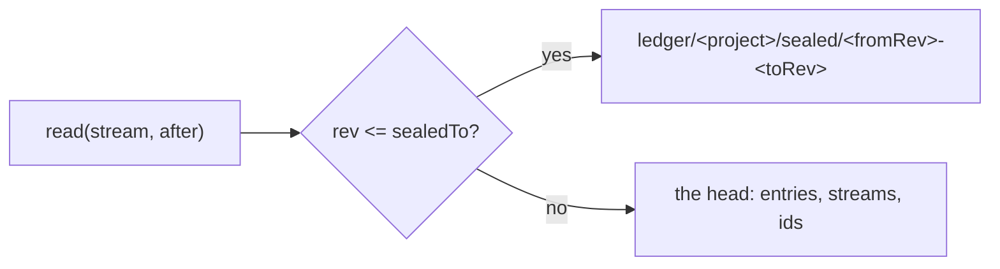

# 0206: In next/, old ledger stretches are sealed into read-only Durable Objects, never R2 files, and the ledger is never sharded by stream, so its one global order holds

**What this decides:** how the project's ledger in `next/` stays under its object's cap without
losing its order.



```ts
// A sketch from the note. The head keeps what it needs to number a write.
// head:   entries (rev > sealedTo), streams (stream, pos), ids (stream, id, rev, hash)
// sealed: ledger/<project>/sealed/<fromRev>-<toRev>, entries only, never written again
const read = rev <= sealedTo ? sealedObjectFor(rev).read(stream, after) : head.read(stream, after);
```

## Context

The owner approved both leans on 2026-11-07 after the bounded-objects walk: sealing at 70%,
no sharding at 85%. Kafka's KIP-405 and KurrentDB's archive move closed stretches out and delete
locally only after the copy (experiment 225). See
[design for bounded objects](../docs/direction/design-for-bounded-objects.md). The note's
"differs" section still calls sealing proposed; its status line, which names the four leans as
decided, wins.

## Decision

**In `next/`, old ledger stretches are sealed into read-only Durable Objects, and the ledger is
never sharded by stream.**

- Sealing comes before Tier 5, or at the first 50% size line, whichever comes first.
- A sealed stretch is a Durable Object, never an R2 file: every rebuild replays the log from its
  start, so old stretches are live data, and a sealed object answers with the same read code, order
  and rules as the head.
- A stretch is deleted from the head only after its sealed object has it.
- The head keeps its `streams` and `ids` rows, since it numbers each write from them.
- No sharding by stream: it would lose the global order, as Kafka's partitions do.

## Consequences

- About 400 to 600 lines, a guess, two new head tables, and a read that may call a second object.
  The `ids` table still grows, only slower.
- What would change it: replays that start from a snapshot, which would make old stretches cold, or
  a sealed read too slow for a window.
