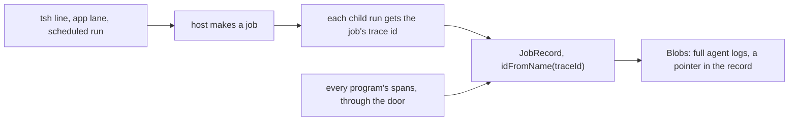

# 0207: In today's version, a job is the host's, and one JobRecord per job, keyed by its trace id, holds its runs' storage and its spans forever, never a LaneRecord per lane

**What this decides:** in today's version, who owns a job and where everything a job leaves behind
is kept.

## Context

First proposed on 2026-10-27 as one record per lane. The owner widened it on 2026-10-28: traces
are for every program, the record is the storage programs already get, and a job is the host's.
See [a JobRecord holds its trace](../docs/direction/a-job-record-holds-its-trace.md). This is
today's version only; `next/`'s record is [0204](0204-process-record-rolls-in-parts.md).

## Decision

**In today's version, anything that starts a program makes a job on the host, and each job has one
`JobRecord`, kept forever.**

- A job is the host's, never tsh's. tsh's `jobs`, `&`, `attach %n` and detach are views and calls
  on the host's jobs.
- One `JobRecord` per job, for every program. `LaneRecord` is dropped: a lane is one kind of job.
- Its key is the job's trace id, from the first run's key, so a job that moves hosts or whose host
  restarts stays one trace in one object.
- A child run joins its parent's job: the host hands the job's trace id to every child it starts.
- The record is the runs' storage: machine states, outbox, dead letters and how each run ended.
  Memory and file storage stay for tests.
- A program is not a Durable Object. Programs still run in their host; only their storage lives in
  the object.
- Jaeger goes. Every program sends its spans to the record, in through the same door as facts,
  which stamps the sender. `trace:up`, `trace:down`, `trace:wipe` and `jaeger/` are removed once
  the trace tile shows a tsh line.
- Nothing in a job's record is deleted.
- Values live in the record's step rows, one row per Msg. Spans keep only names, tags and ids.
- Full agent logs stay in `Blobs`, with only a pointer in the record.

## Consequences

- `jaeger/` and the `trace:*` scripts are still on main, waiting on the trace tile.
- The note's "size is not a worry" is wrong for a long-lived record:
  [0200](0200-no-object-grows-forever.md) and [0204](0204-process-record-rolls-in-parts.md) hold
  for `next/`.
