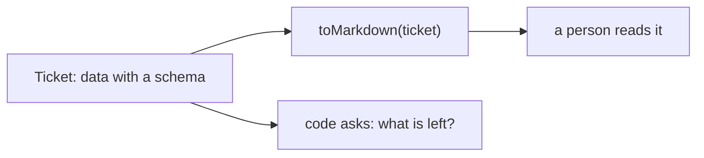

# 0208: Every shape the pipeline works with is data with a schema first, and markdown is a view made from it by a function, never read back to learn what is true

**What this decides:** a ticket, a criterion, a finding, a verdict, a ruling and a step's answer are
data; markdown only shows them.



```ts
// From the note. The data is the truth; the view is made from it and never read back.
const toMarkdown = (t: Ticket): string =>
  [`# ${t.title}`, "", ...t.criteria.map((c) => `- [${c.deliveredBy ? "x" : " "}] ${c.text}`)]
    .join("\n");
const left = ticket.criteria.filter((c) => c.deliveredBy === null);
```

## Context

Today's fabrika kept what it knows as prose, so learning anything meant an agent reading it.
Decided 2026-10-11. See [data first, markdown is a view](../docs/direction/data-first-markdown-is-a-view.md).
It holds for both versions.

## Decision

**Every shape the pipeline works with is data with a schema first; markdown is a view made from that
data, and nothing reads the markdown back to find out what is true.**

- A thing's schema is designed before its wording. If a step needs a fact, the fact gets a field.
- Markdown the pipeline writes, a file or a comment, is made by a function from data. Hand-written
  markdown that the pipeline later has to read is a sign a schema is missing.

## Consequences

- Not decided here: what happens when a person edits the view by hand. The note leaves it open.
