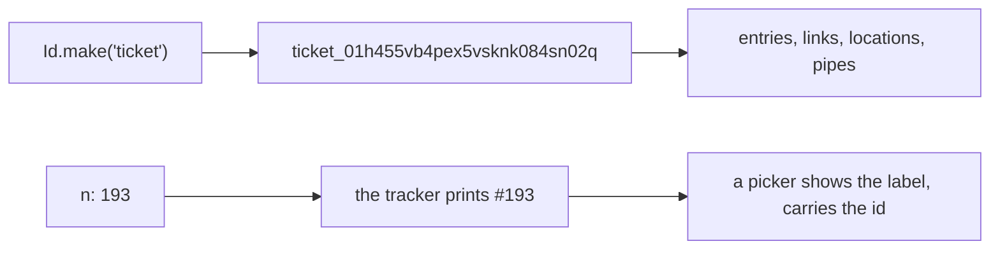

# 0211: In next/, every thing has one id, a TypeID made with Id.make, data points only at that id, and a counted thing's n is printed and parsed only by the program that owns it

**What this decides:** how a thing in `next/` is named in data, and how people's numbers for it
are kept apart from that.



```ts
// next/packages/libfabrika/src/Id.ts
export const make = <const P extends string>(prefix: P): Specific<P> => { /* ... */ };
export const Input = make("input");

// A picker row, from the note: the id stays hidden, the label is the owner's print of n.
{ id: t.id, label: `#${t.n}`, title: t.title }
```

## Context

Decided 2026-11-07. Input ids followed on 2026-11-08, which closed Tier 1's question 20. The note
"one id per thing" held it first; it is removed, and this file holds its rules.

## Decision

**In `next/`, every thing has one id, `<type>_<suffix>`, where the suffix is a UUIDv7 written as
26 Crockford base32 characters: the TypeID format.**

- An id type is made where it is needed with `Id.make("ticket")`, a branded Schema. A `TicketId`
  cannot pass where another type's id is wanted, and a bad string fails at decode.
- Data always points at the id: a ledger entry, a link, a location or a pipe names the id, never a
  number or a title.
- A thing people count also gets `n: Schema.Int`. Only the program that owns the thing prints it
  (`#193`, `build:7`) and parses it back.
- The desk, pickers and the shell never parse an `n`. They carry the id and show the label the
  owning program gave them.
- An input id is a TypeID too, `input_<26 chars>` (2026-11-08). The gateway's process and count are
  their own fields on the entry, never packed into the id.

## Consequences

- A UUIDv7 starts with its time, so ids sort by when they were made.
- `ProcessId` and some entry and member ids were still loose strings when the note was written;
  they move to `Id.make` in build pull requests.
- Which things get an `n` is decided per program.
