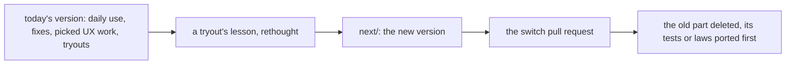

# 0217: The new version grows in next/ beside today's, imports nothing from it, and the pull request that switches a job over deletes the old part once its tests are ported

**What this decides:** how the two versions live on main, and how today's version goes away.

## Context

The owner chose a clean slate on 2026-10-30: the core is rebuilt on the new picture, not swept in
place. On 2026-10-31 it changed to build beside, because "replace a whole layer in one pull
request" had no answer for the tracker, which is used every day. This is Martin Fowler's strangler
fig. See [clean slate](../docs/direction/clean-slate.md). AGENTS.md says the same.

## Decision

**The new version grows in `next/` beside today's, which keeps running until each job has moved.**

- `next/` imports nothing from today's version, and copies nothing across.
- The core is rebuilt too, never swept in place.
- When `next/` takes a job over, the pull request that switches to it deletes the old part, only
  once the new home works and the old part's tests or laws are ported.
- Today's version takes only fixes that daily use or CI needs, the UX work the owner picks
  ([0063](0063-todays-app-lanes-share-the-slots.md)), and tryouts the owner asks for. What a
  tryout teaches goes into `next/` as a lesson, rethought, never copied.

## Consequences

- A search finds two versions until the old one is gone, so every claim says which version it is
  about.
- The risk is that the old version lives forever; each tryout makes it a little bigger.
