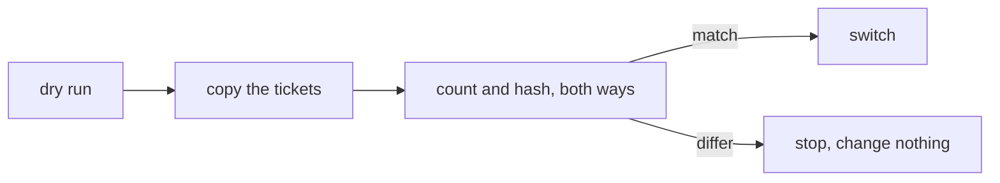

# 0219: Switching to next/'s tracker needs a checked copy of the tickets, counted and hashed both ways after a dry run, never a straight copy

**What this decides:** what has to be true before people's tickets move from today's tracker to
`next/`'s.

## Context

Set in the clean-slate order at 80%. The order around it was replaced on 2026-11-01 by the tiers;
this condition was not withdrawn. See [clean slate](../docs/direction/clean-slate.md).

## Decision

**The switch to `next/`'s tracker copies the tickets, then counts and hashes them both ways, with a
dry run first; a straight copy is never enough.**

- A straight copy is not safe: today's `pos` and `rev` mean the opposite of `next/`'s data layer.
- The new tracker starts read only.

## Consequences

- Whether the old tracker can keep working against its ledger while the copy is tried is not known;
  the dry run settles it.
