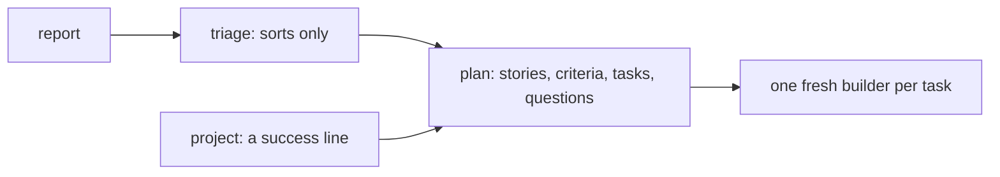

# 0220: In today's pipeline, plan is its own step for every ticket and the one shape of work, an epic is a plan with many tasks and a project is a parent plan, and milestones leave the loop

**What this decides:** how work is shaped between triage and build, from a one-line bug to a
project.

## Context

Decided 2026-10-18. A study of demlik's board found that after triage nothing read a milestone but
one tiebreak, and nothing closed milestones or campaigns. See
[a project is a parent plan](../docs/direction/a-project-is-a-parent-plan.md). The note says
"stage" for a step. `next/`'s pipeline is designed fresh from how work gets done
([0059](0059-pipeline-starts-from-the-work.md)), with these notes as its input.

## Decision

**Plan is its own step for every ticket, and the plan is the one shape of work.**

- Triage only sorts (a duplicate? worth it? who owns it?). It writes no criteria and no design.
- A plan is data kept outside any builder, so each task gets a fresh builder. Its size follows the
  work: a small bug is a one-task plan.
- An epic is a plan with many tasks. A project is a parent plan: a success line plus child plans.
  There is no separate shape.
- A plan's shape can cover several tickets, each story naming the ticket it came from. For now
  each plan covers one, since triage does not fold.
- A project closes itself when its children are done and its success check passes.
- Nothing in the pipeline reads or writes GitHub milestones. A roadmap is a view built from plans.
- Progress toward a goal is computed from plans, never kept by hand.

## Consequences

- Which tickets a merge closes is [0015](0015-a-pr-phrase-closes-its-tickets.md)'s rule, not "the
  pull request closes every ticket the plan covers".
- A plan cuts big work into slices that each land whole
  ([0099](0099-no-number-caps-a-pull-request.md)), not one pull request.
