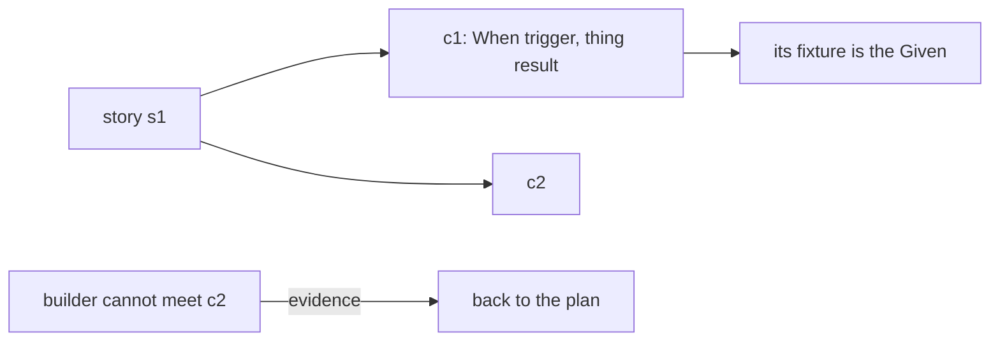

# 0221: In today's pipeline, a plan's criteria are When and Then lines that each serve a story, never name internal code and change only through the plan, and its open questions block

**What this decides:** what a plan must hold, and who may change it.

## Context

Decided 2026-10-18, kept as is for now. Experiment 87 found the Given/When/Then shape fits real
tickets (27 of 27 scenarios red before the fix, green after), but Gherkin tooling did not pay: no
glue was reused across tickets. See
[a project is a parent plan](../docs/direction/a-project-is-a-parent-plan.md).

## Decision

**A plan holds user stories first, and every criterion serves one of them.**

- A criterion has the Given/When/Then shape, written "When trigger, thing result", with its fixture
  as the Given. No Gherkin tooling.
- Every story has an id, every criterion serves a story, every story is served by at least one
  criterion, and code checks the links.
- The first criterion is the user's whole job, on a realistic fixture: more than two items, a
  second run, or a large input.
- A criterion never names internal code (files, functions). Names a user types are fine.
  Internals go in pointers, which bind nobody.
- A builder that cannot meet a criterion as written sends it back to the plan, with evidence. It
  never edits the criteria.
- A plan's open questions block until the owner answers. "Build on the lean and ask without
  blocking" was turned down.
- Two later rules narrow which questions reach the owner: a call a decided note already answers is
  decided in the plan (AGENTS.md, 2026-11-08), and while the owner is away the lead builds its lean
  as a pull request that stays unmerged where the call is the owner's alone
  ([0096](0096-the-lead-fixes-forward-while-the-owner-is-away.md)).

## Consequences

- A slice that grows past its plan's own estimate also goes back to the plan
  ([0100](0100-a-slice-over-its-own-estimate-goes-back-to-the-plan.md)).
