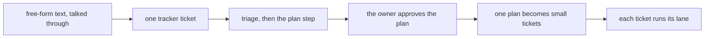

# 0222: A large plan enters the pipeline as free-form text in one tracker ticket that the plan step turns into the real plan, a tier is a project, and only Tier 1 was split into tickets by hand

**What this decides:** how a big plan talked through in free form becomes tickets.

## Context

Decided 2026-11-01, with all its leans: the flow at 85%, Tier 6 at 70%. The owner expects to use
this flow a lot. See [a free-form plan goes to the planner](../docs/direction/free-form-plan-to-planner.md).

## Decision

**A large plan enters the pipeline as free-form text filed as one tracker ticket, and the plan step
turns that text into the real plan the owner approves.**

- A tier is a project.
- Tier 1's split into tickets went by hand, once, as a named exception: after the owner's yes, an
  agent filed each task with the tracker's own `file` input and logged it in `field/`.
- No other project is split by hand without the owner's yes.
- No splitter is built on today's version.
- The whole flow, from the free-form text to several small tickets, is a `next/` requirement in
  Tier 6. A rerun after a partial filing must never file twice, and in `next/` code holds that.

## Consequences

- Tiers 2 to 5 are each a project, so each needs the owner's yes to split by hand, or the flow
  moves up.
- Not decided here: who approves a tier's breakdown. The note says the owner, on the planner's plan;
  AGENTS.md lets the lead approve a plan that only builds a decided note. That waits on the owner.
