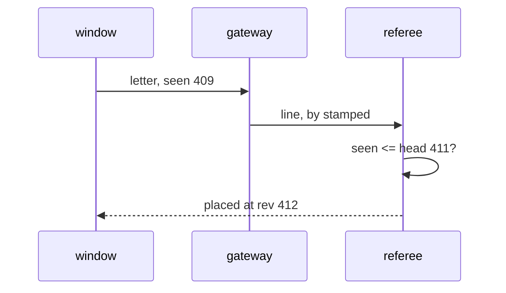

# 0225: In next/, every ledger entry carries seen, the last rev its writer had folded, filled by libfabrika and bounded by the referee, and it never decides a lease, a limit, money or a grant

**What this decides:** how an entry in `next/` records what its writer had seen when it acted.



```ts
// next/packages/libfabrika/src/ledger/Log.ts: what a writer hands in to `append`.
export const Line = Schema.Struct({
  by: Text,
  for: Text,
  sentAt: Schema.String, // the writer's own clock: shown, never decides
  seen: Rev, // the last rev the writer had folded (S1)
  // ...parent, traceId, build, _tag, body
});
// ledger/internal/ledgerStore.ts: the referee's one check.
line.seen > head
  ? Option.some(Placing.cases.refused.make({ reason: "seen_ahead" }))
  : Option.none();
```

## Context

Decided by the owner on 2026-11-01, S1 at 85% and the smaller calls at 65% to 70%. Kubernetes uses
`resourceVersion` to detect a client that is out of date; with one referee, the set of parents is
one number. See [saved state](../docs/direction/saved-state.md).

## Decision

**In `next/`, every ledger entry carries `seen`, the log's rev of the newest entry its writer had
folded, filled by libfabrika and never by a program's author.**

- A window fills it with the ledger rev of the view the act came from. A process fills it with the
  rev of the letter it is stepping. The referee's own entries use its head.
- An agent's `seen` is the newest rev any read answered it from, never the rev its brief was built
  at (65%).
- The referee refuses an entry whose `seen` is past its head, with `seen_ahead`, in the same call
  that places it. It checks no lower bound: one key may run several windows, and a reload starts
  low.
- `seen` is a bounded claim, not a proven one. A program may refuse a stale act with it; leases,
  limits, money and grants decide on `arrivedAt` and fences only.
- A window Msg carries no `saw`: the log's rev rides on the envelope as `seen` (70%).
- `Line` requires `seen`, so a writer that leaves it out does not compile.

## Consequences

- Today's ledger gets no `seen`; today's lane keeps P5's `during`. In `next/`, `during` is a fold
  over `seen`, never a stored field.
- The doubt: nothing reads `seen` in Tier 1 but the bound. Counting saves whose `seen` is older than
  the note's last change would settle it.
